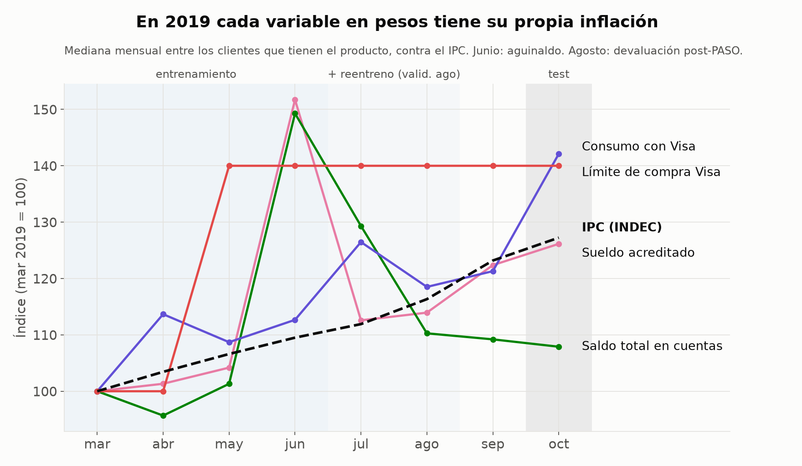
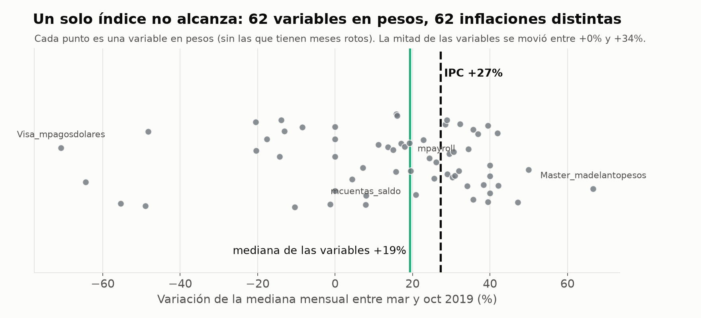
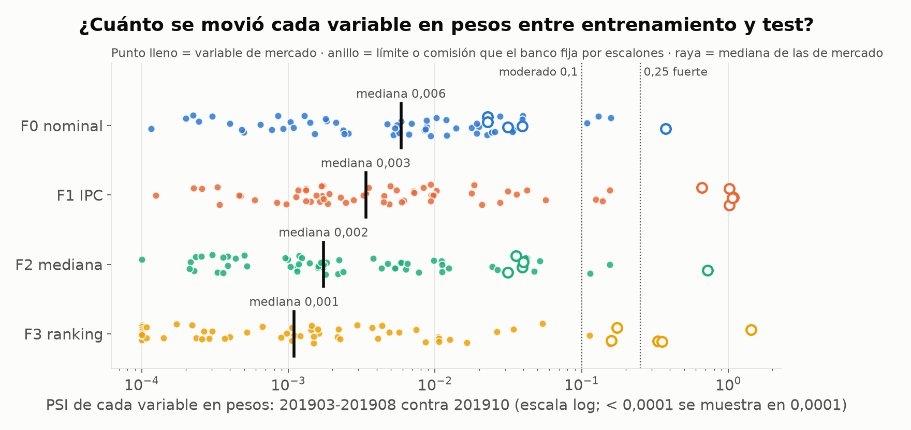
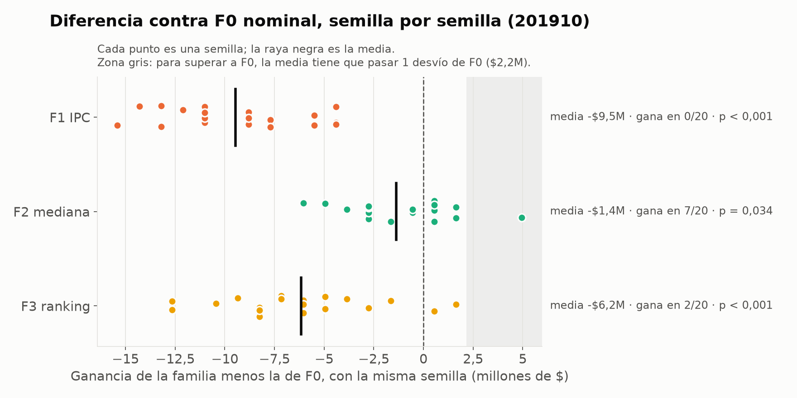

# Experimento colaborativo: inflación (grupo Inflacion_2)

DMEyF 2026. Ana Dominguez, Nicolás Zarewsky y Valentín Turri. Tutor: Joaquín I. Aramendía.
Entrega: video grupal (máximo 10 minutos) antes del mediodía del lunes 23/11; discusión en clase el martes 24/11.

## Hipótesis

> Corregir la inflación de las variables en pesos usando solo los datos del propio mes (dividiendo por la mediana del mes o pasándolas a ranking) da más ganancia en 201910 que no corregirla, y al menos la misma que deflactar por IPC, sin depender del INDEC.

Por qué importa lo de "sin depender del INDEC": en producción (como en la Segunda Competencia, donde cada mes nuevo se procesa en vivo) el IPC del mes recién se publica a mitad del mes siguiente. Una corrección interna está disponible el mismo día que llegan los datos.

La hipótesis se separa en dos preguntas, porque pueden dar distinto:

- **(a) ¿Baja el drift?** Se mide sin el modelo de churn, comparando distribuciones (PSI y AUC adversarial).
- **(b) ¿Sube la ganancia?** Se mide con el modelo, en 201910.

Si (a) da que sí y (b) que no, también es un hallazgo.

## Por qué tendría que funcionar (evidencia del dataset)

El modelo aprende umbrales en pesos de marzo a agosto de 2019 y los aplica en octubre. Entre marzo y octubre el IPC subió 27%. Un árbol que aprendió "saldo menor a 50.000" en marzo aplica el mismo umbral en octubre, cuando 50.000 pesos ya valen otra cosa.



Pero cada variable tiene su propia "inflación" (`scripts/00_diagnostico_inflacion.py`, mediana mensual entre los clientes que tienen el producto):

- el sueldo acreditado sigue al IPC (+26% contra +27%), con un salto de +52% en junio por el aguinaldo;
- el saldo total en cuentas sube apenas 8%;
- el consumo con Visa sube 42%;
- el límite de compra Visa no se mueve mes a mes: el banco lo ajusta por escalones (+40% de golpe en mayo);
- las variables en dólares expresadas en pesos saltan con la devaluación post-PASO de agosto.



De las 62 variables en pesos sin meses rotos, la mitad se movió entre 0% y +34% entre marzo y octubre (mediana +19%; percentil 10: -20%; percentil 90: +40%). Un único índice externo no puede corregirlas a todas. La mediana del mes corrige cada variable con su propio movimiento, y además absorbe el aguinaldo.

## Diseño experimental

### Baseline (consigna de Ale, con sus aclaraciones en el hilo de Zulip)

| | |
|---|---|
| Datos | solo 2019. 201911 (solo BAJA+1) y 201912 (sin clase) son del dashboard: no se usan |
| Features | las 152 originales + lag y delta de orden 1 y 2 (760 columnas) |
| Target | BAJA+1 y BAJA+2 juntas |
| Entrenamiento | 201903, 201904, 201905 y 201906 completos, sin sampling |
| Validación | 201908, con AUC: ordena la bayesiana y hace el early stopping |
| Test | 201910, con ganancia, solo para comparar. Se reentrena con 201903-201908 |
| Bayesiana | `num_leaves`, `learning_rate`, `min_data_in_leaf`, `feature_fraction`, `bagging_fraction`; `bagging_freq` = 1; el resto en el default de LightGBM |
| Ganancia | +1.072.500 por cada BAJA+2 estimulado, -27.500 por cada estímulo a un cliente que no es BAJA+2 |

### Las 4 familias

La única diferencia entre familias es cómo se corrigen las variables en pesos **antes** de calcular lags y deltas. El valor corregido **reemplaza** al original (misma columna, mismo nombre): todas las familias tienen exactamente las mismas 760 columnas. Si se agregaran columnas, no se sabría si mejoró por la corrección o por tener más variables.

| Familia | Qué se hace con cada variable en pesos | Datos externos |
|---|---|---|
| **F0 nominal** | nada (el baseline) | no |
| **F1 IPC** | `x * IPC[201910] / IPC[mes]`: todo en pesos de octubre 2019 | sí, IPC del INDEC |
| **F2 mediana** | `x / mediana(|x|)` del mes, entre los clientes con x distinto de 0 | no |
| **F3 ranking** | posición del cliente en el mes, con el cero fijo: positivos en (0, 1], negativos en [-1, 0), el 0 queda en 0 | no |

Decisiones de diseño (cada una con su porqué):

- **Qué variables se corrigen**: las 73 que el diccionario de datos marca con unidad "pesos", que son exactamente las que empiezan con `m`, `Visa_m` o `Master_m` (la misma convención que usa la cátedra). Cantidades (`c...`), flags, edad, antigüedad, días y fechas quedan igual. Las que nacen en dólares (`mcaja_ahorro_dolares`, `Visa_mconsumosdolares`, etc.) están incluidas porque el diccionario dice que vienen "expresadas en pesos" al tipo de cambio de cierre: también se mueven, pero con el dólar. F2 y F3 las corrigen con su propio movimiento; F1 les aplica el IPC igual (es lo que dice "todo dividido por el IPC"); corregirlas con el tipo de cambio es justamente lo que estudia Inflacion_1.
- **F2 y las medianas en cero**: muchas variables tienen mediana 0 (la mayoría no tiene plazo fijo, préstamos, etc.). En vez de una regla para esas y otra para el resto, **todas** se dividen por la mediana de los clientes que tienen el producto (valores distintos de 0), en valor absoluto. Es una sola regla, respeta el signo de saldos y márgenes negativos, y no se mueve si cambia la proporción de clientes sin el producto. La mediana es solo un número para hacer la cuenta: el modelo nunca la ve.
- **F3 y los empates**: los clientes con el mismo monto comparten el mismo valor (la fracción de clientes con un monto menor o igual).
- **F1 y el mes de referencia**: multiplicar todo por una constante no cambia los árboles, así que llevar todo a pesos de octubre o de marzo da el mismo modelo. Serie del INDEC: IPC Nacional, nivel general, base diciembre 2016 = 100 (serie `148.3_INIVELNAL_DICI_M_26` de datos.gob.ar).
- **Celdas rotas**: no se corrigen, igual que en el baseline (ver Limitaciones).

### Protocolo de comparación

1. **Optimización bayesiana por familia** (`scripts/03_optimizar.py`): Optuna (TPE), 50 intentos, misma semilla y mismo rango en las 4 familias. Entrena 201903-201906 y mide AUC en 201908 con early stopping (200 rondas, máximo 5.000 árboles).

   | Hiperparámetro | Rango |
   |---|---|
   | `num_leaves` | 8 a 1.024 (escala log) |
   | `learning_rate` | 0,005 a 0,3 (escala log) |
   | `min_data_in_leaf` | 10 a 8.000 (escala log) |
   | `feature_fraction` | 0,1 a 1 |
   | `bagging_fraction` | 0,2 a 1 |

   Fijos: `bagging_freq` = 1, `max_bin` y todo lo demás en default. `deterministic` y `force_row_wise` solo fijan el orden de las sumas, para que la misma semilla dé siempre el mismo modelo.

2. **Corte**: el mejor intento de cada familia también define cuántos clientes estimular, eligiendo el corte que maximiza la ganancia en 201908. Así el corte **no se elige mirando el test**.
3. **Modelo final** (`scripts/04_entrenar_final.py`): reentreno con 201903-201908 con los hiperparámetros y la cantidad de árboles de la bayesiana, **20 semillas por familia** (las mismas 20 en las 4: las 5 asignadas a Nicolás y los 15 primos siguientes). Para cada semilla: ganancia en 201910 en el corte de validación (métrica principal), ganancia máxima de la curva (optimista, solo de referencia) y AUC.
4. **Regla de decisión, fijada antes de mirar el test** (`scripts/06_resumen.py`): una familia supera a F0 si (1) su ganancia media supera a la de F0 por más que el desvío entre semillas de F0, y (2) el test de Wilcoxon pareado por semilla da p < 0,05. F2 y F3 "rinden al menos como el IPC" si su diferencia media contra F1 es mayor o igual a 0, o si no es significativamente peor (Wilcoxon p >= 0,05).
5. **Medición del drift** (`scripts/05_drift.py`), para responder (a): entre 201903-201908 y 201910, solo variables en pesos y sin las que tienen celdas rotas (62).
   - **PSI** por variable (deciles de la referencia, más un intervalo para el 0 y otro para el nulo).
   - **AUC adversarial**: qué tan bien un LightGBM distingue filas de octubre de filas de marzo a agosto (0,5 = no se distinguen).

## Resultados

### (a) ¿Baja el drift? Sí para las variables de mercado, pero no para todas



| Familia | PSI mediano (todas) | PSI mediano, variables de mercado | PSI mediano, límites y comisión | Variables con PSI > 0,1 | AUC adversarial (continuas) | AUC adversarial (todas) |
|---|---|---|---|---|---|---|
| F0 nominal | 0,008 | 0,006 | 0,031 | 6% | 0,810 | 0,892 |
| F1 IPC | 0,004 | 0,003 | 1,014 | 13% | 0,874 | 1,000 |
| F2 mediana | 0,002 | 0,002 | 0,039 | 5% | 0,854 | 0,921 |
| F3 ranking | 0,001 | 0,001 | 0,330 | 11% | 0,867 | 1,000 |

Lectura:

- **Para la variable típica** (saldos, consumos, pagos) las tres correcciones bajan el drift, de menor a mayor efecto: IPC, mediana, ranking. Ejemplo: consumo con Visa, PSI 0,034 sin corregir, 0,003 con IPC, 0,001 con mediana, 0,000 con ranking.
- **Las variables que el banco fija por escalones** (límites de compra y de financiación, comisión de mantenimiento) no se mueven mes a mes con la inflación. Deflactarlas con IPC les inventa una caída real todos los meses hasta el próximo escalón (PSI de 0,03 a 1,01). El ranking también las empeora, por los empates. **La mediana es la única que las deja como estaban**: su mediana cae justo sobre un escalón.
- **El AUC adversarial no baja con ninguna corrección.** Con todas las variables, IPC y ranking llegan a 1,000, pero es un artefacto: en las variables con pocos valores distintos (límites), cada mes queda con un valor exacto propio después de corregir, y el clasificador reconoce el mes por esa "huella". Aun usando solo variables continuas, octubre sigue siendo distinguible (0,81 a 0,87). Lo explican cambios de comportamiento que no son inflación: consumo y pagos en dólares con tarjeta, venta de dólares, débitos automáticos, extracciones. Octubre de 2019 es post-PASO (devaluación de agosto, cepo de septiembre), y ninguna corrección del nivel de precios saca eso.

### (b) ¿Sube la ganancia? No: ninguna corrección le gana al nominal

**En validación (201908) las cuatro familias ya venían parejas.** La bayesiana terminó con AUC entre 0,9316 y 0,9334, con el nominal arriba: los 5 mejores intentos de F0 superan al mejor de F2 y al mejor de F3. La ganancia en 201908 del mejor intento es ruidosa: entre los 5 mejores intentos de una misma familia varía hasta $8M.

| Familia | AUC 201908 | Árboles | Corte elegido en 201908 | Ganancia 201908 |
|---|---|---|---|---|
| F0 nominal | 0,9334 | 715 | 4.000 | $216,7M |
| F1 IPC | 0,9331 | 612 | 5.000 | $209,0M |
| F2 mediana | 0,9323 | 1.125 | 3.900 | $208,4M |
| F3 ranking | 0,9316 | 1.223 | 3.500 | $212,8M |

**En el test (201910), con la regla fijada antes de mirarlo, ninguna corrección supera al nominal.** Reentreno con 201903-201908, las mismas semillas en las 4 familias y el corte que eligió cada una en 201908:

| Familia | Ganancia 201910 (20 semillas) | Contra F0 | Semillas en que le gana a F0 | Wilcoxon p | AUC 201910 | Ganancia máxima (optimista) |
|---|---|---|---|---|---|---|
| F0 nominal | $289,0M ± $2,2M | | | | 0,9364 | $290,5M |
| F1 IPC | $279,6M ± $3,4M | -$9,5M | 0 de 20 | < 0,001 | 0,9362 | $283,2M |
| F2 mediana | $287,6M ± $2,1M | -$1,4M | 7 de 20 | 0,034 | 0,9376 | $289,7M |
| F3 ranking | $282,9M ± $3,0M | -$6,2M | 2 de 20 | < 0,001 | 0,9366 | $291,2M |

El ± es el desvío entre semillas. La "ganancia máxima" elige el mejor corte de cada semilla mirando el test: solo sirve de referencia. Las tablas completas están en `output/resumen.md` y cada semilla en `output/resultados_por_semilla.csv`.




Lectura:

- **El IPC es la peor opción.** Pierde contra el nominal en las 20 semillas y en todos los cortes de la zona del máximo. Es coherente con (a): un solo índice para variables que se mueven distinto, y caídas reales inventadas en los límites y comisiones que el banco ajusta por escalones.
- **La mediana es la que menos pierde**: -$1,4M, menos que el desvío entre semillas de F0, y le gana en 7 de las 20 semillas. Es casi un empate, aunque el Wilcoxon da la diferencia como significativa (p = 0,034). Tiene el mejor AUC de las cuatro, pero ordenar mejor a todos los clientes (el AUC cuenta también a los BAJA+1) no se traduce en más ganancia entre los primeros 4.000, que es donde se decide.
- **El ranking pierde por el corte más que por el orden.** Su validación eligió estimular 3.500 clientes, pero en octubre su curva es la más alta a partir de los ~4.100. Si las cuatro familias estimularan la misma cantidad de clientes, con 4.000 F3 empata con F0 ($288,9M contra $289,0M) y con 4.500, 5.000 o 6.000 le gana por $2,5M a $4,2M (tabla exploratoria en `output/resumen.md`). Elegir el corte mirando el test es justamente lo que la regla prohíbe: queda como hipótesis para probar, no como resultado.
- **La segunda parte de la hipótesis sí se cumple**: mediana y ranking le ganan al IPC (F2 por $8,1M, en 20 de 20 semillas; F3 por $3,3M, en 15 de 20; las dos con Wilcoxon p < 0,01).

**¿Por qué bajar el drift no sube la ganancia?** El experimento no lo separa, pero hay dos explicaciones compatibles con los datos:

1. El cambio de octubre que más pesa no es de precios: el AUC adversarial no bajó con ninguna corrección (comportamiento en dólares post-PASO).
2. Un árbol no cambia si una variable se transforma de forma monótona dentro de un mes: la corrección solo cambia cómo se comparan meses distintos. Y puede que buena parte de la señal esté en variables que la inflación no toca (cantidades, flags, antigüedad).

## Limitaciones

- **Un solo mes de test (201910) y una sola bayesiana por familia.** El desvío entre semillas no incluye la variabilidad de la optimización.
- **Celdas rotas**: 201910 (el test) tiene 14 variables en 0 para todos los clientes (rentabilidad, comisiones, márgenes, descuentos, transacciones de home banking) y 201905 (entrenamiento) tiene 9. Afectan a las 4 familias por igual; no son parte de este experimento (`output/celdas_rotas.csv`).
- **F1 usa el IPC de octubre como si estuviera disponible**: en producción no lo estaría. Es una ventaja informativa a favor de F1.
- **Normalizar por mes borra también los cambios reales**: si todo el banco se empobrece en un mes, F2 y F3 no lo ven (cada cliente sigue en su lugar relativo).
- **El ranking pierde la escala**: el cliente que más tiene vale 1 sea cual sea su monto.
- **Octubre de 2019 no es un mes cualquiera**: la devaluación post-PASO cambió el comportamiento en dólares, y eso no es inflación.
- **2019 no tiene la pandemia**: el shock de 2020 queda afuera.
- **Mismos árboles al pasar de 4 a 6 meses de entrenamiento**: el reentreno usa la cantidad de árboles que encontró el early stopping con 4 meses.
- **El corte sale de un solo modelo en 201908** (el mejor intento de la bayesiana): es ruidoso, y en F3 cayó lejos del mejor corte de octubre.

## Conclusiones

- **En 2019, con el baseline de la cátedra, corregir la inflación de las variables en pesos no sube la ganancia.** Con la regla fijada antes de mirar el test, el nominal le gana a las tres correcciones. La hipótesis principal no se sostiene.
- **Si se corrige, que no sea con el IPC**: es la peor de las tres en ganancia y la que más distorsiona las variables que el banco ajusta por escalones. Las correcciones con datos del propio mes le ganan, y además no dependen del INDEC.
- **Bajar el drift no alcanza**: las tres correcciones bajan el PSI de la variable típica, pero el cambio de octubre que no es de precios sigue ahí, y la ganancia no sube. Medir el drift por separado de la ganancia evitó dar por hecho que menos drift es mejor modelo.
- **El corte pesa tanto como la corrección**: con 4.500 clientes o más, el ranking queda arriba del nominal (análisis exploratorio, mirando el test).

### Lo que el diseño nos cuidó de creer

Esperábamos que corregir ayudara (sesgo de confirmación). Mirando la curva de octubre es fácil encontrar un corte en el que el ranking "gana". La regla de decisión y el corte, fijados antes de mirar el test, evitaron declarar ese resultado.

### Qué seguiríamos probando

1. Elegir el corte de forma más estable (por ejemplo, con el promedio de varias semillas en 201908, o maximizando la ganancia promedio en una ventana de cortes) y ver si el ranking se sostiene.
2. Agregar la versión corregida como columnas nuevas, sin sacar las nominales, y dejar que el modelo elija.
3. Corregir solo las variables de mercado y dejar en nominal las administradas (límites, comisión de mantenimiento).
4. Repetir con 2020-2021, el resto del dataset de la Segunda Competencia: más meses de test, pandemia y otra dinámica de precios.
5. IPC con un mes de rezago, que es el que estaría disponible en producción.

## Cómo correrlo

Requiere [uv](https://docs.astral.sh/uv/) y el dataset `competencia_02_crudo.csv.gz` en `data/` (o la variable de entorno `CRUDO` apuntando a él).

```bash
uv sync
uv run python scripts/01_preparar_base.py        # 2019 + clase_ternaria            (~1 min)
uv run python scripts/02_corregir_y_fe.py        # 4 familias: corrección + lags     (~1,5 min)
uv run python scripts/00_diagnostico_inflacion.py  # gráficos de diagnóstico         (segundos)
uv run python scripts/05_drift.py                # PSI y AUC adversarial             (~30 s)
uv run python scripts/03_optimizar.py            # bayesiana, 4 x 50 intentos        (~7 h)
uv run python scripts/04_entrenar_final.py       # 4 familias x 20 semillas          (~5 h)
uv run python scripts/06_resumen.py              # tablas, tests y gráficos
```

Tiempos medidos en una MacBook Pro M3 Pro (12 núcleos, 36 GB). La bayesiana tardó entre 1 h 45 min y 2 h por familia (de 12 segundos a 7 minutos por intento, unos 2 minutos el típico) y el reentreno final, de 3 a 5 minutos por semilla según la familia y ocupa ~7 GB de memoria (medido): entra en una máquina de 16 GB cerrando lo demás. Opciones útiles:

- `--metodos mediana ranking` en 02, 03, 04 y 05 para correr solo algunas familias.
- `--semillas 100081 100103` en 04 para correr solo algunas semillas. Si una semilla ya tiene resultado, se saltea (`--forzar` para rehacerla).
- 03 retoma solo si se corta (el estudio de Optuna queda en `data/optuna.db`).
- `HILOS=6` limita los núcleos que usa LightGBM.

### Cómo repartir el trabajo sin romper la comparación

Todos con este mismo repo, las mismas versiones de librerías (`uv.lock`) y las mismas semillas. La bayesiana de cada familia la puede correr cualquiera: lo que se comparte es `resultados/bo__<familia>.json`. El reentreno final de las 4 familias conviene correrlo **en una sola máquina**, para que las diferencias entre familias no vengan de diferencias numéricas entre computadoras.

## Qué hay en cada carpeta

```
scripts/      00 a 06 (ver arriba), config.py (todas las constantes) y comun.py
data/         crudo, base por mes, features por familia y estudio de Optuna (no se versiona)
resultados/   bo__<familia>.json y bo__<familia>__intentos.csv (bayesiana);
              final__<familia>__<semilla>.json y curva__<familia>__<semilla>.csv (test);
              prediccion__*.parquet (probabilidades por cliente, no se versiona)
output/       gráficos, tablas (resumen.md, resultados_por_semilla.csv, drift_*.csv, celdas_rotas.csv)
              y logs/ de cada corrida
```

## Qué se reutilizó

- La consulta de `clase_ternaria` y la lógica de lags y deltas vienen del pipeline de la Primera Competencia (`candidatos/competencia_01`, porteo de `dmeyf2026/monday/z101_target_sql.ipynb` y `z402_Feature_Engineering_en_SQL.ipynb`). Se validó que, sin corrección, las features de 202106 coinciden celda por celda con las de ese pipeline.
- Antecedente: en la Primera Competencia, el ranking con cero fijo aplicado a todas las columnas (intento 15) subió la ganancia del holdout local (~$370M contra ~$360M) pero bajó la ganancia pública (75,9 contra 80,0). Allá el entrenamiento era de 4 meses de 2021 con poca distancia al mes predicho; acá la distancia entre entrenamiento y test es mayor y en el medio hubo una devaluación.
