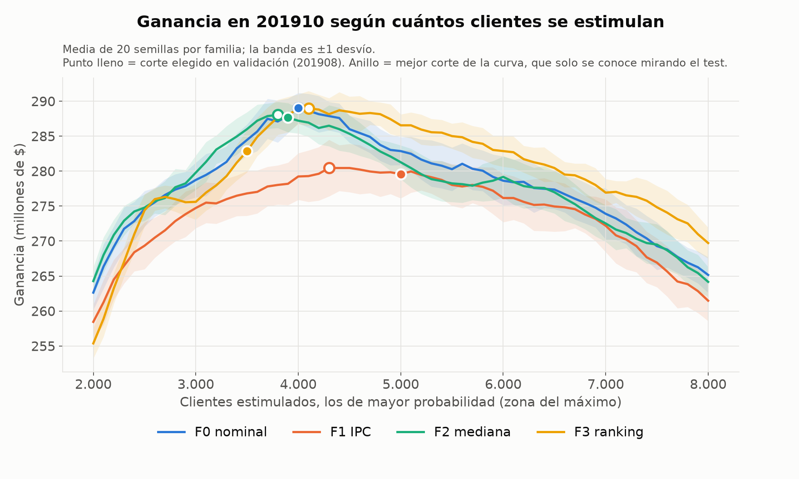
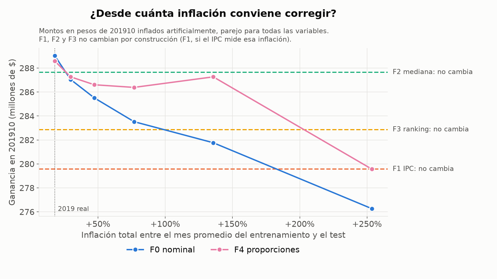
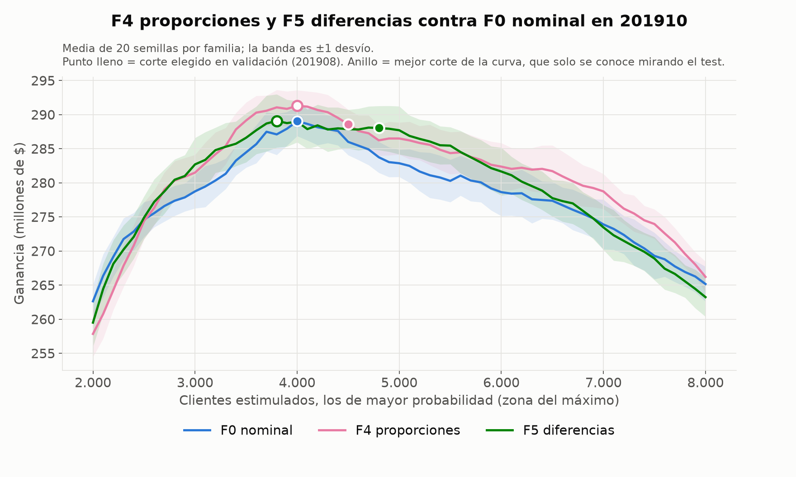

# Experimento colaborativo: inflación (grupo Inflacion_2)

DMEyF 2026. Ana Dominguez, Nicolás Zarewsky y Valentín Turri. Tutor: Joaquín I. Aramendía.
Entrega: video grupal (máximo 10 minutos) antes del mediodía del lunes 23/11; discusión en clase el martes 24/11.

## En un minuto

**La pregunta.** El modelo aprende umbrales en pesos con datos de marzo a agosto de 2019 (por ejemplo, "saldo menor a $50.000") y los aplica en octubre, cuando los precios ya subieron. ¿Conviene corregir la inflación de las variables en pesos antes de entrenar?

**La hipótesis.** Corregir con datos del propio mes (dividir por la mediana del mes o pasar a ranking) da más ganancia que no corregir, y al menos la misma que deflactar por IPC, sin depender del INDEC.

**La respuesta: no.** Con el baseline de la cátedra y una regla de decisión fijada antes de mirar el test:

- **Ninguna corrección le gana al modelo sin corregir.** La mediana casi empata (-$1,4M sobre $289M), el ranking pierde $6,2M y el IPC, $9,5M.
- **La mediana y el ranking sí le ganan al IPC**, pero esa diferencia no resiste el azar de qué clientes caen en el mes.

**Por qué corregir no ayuda.** Tres hallazgos que apuntan a lo mismo:

1. **Los modelos casi no miran el nivel de precios.** En todas las familias, corrijan o no, entre el 60% y el 70% de la ganancia de los cortes sobre montos pregunta si el cliente tiene poco o nada, y la inflación casi no mueve esos umbrales bajos. Corregir cambia la escala, pero no esa pregunta.
2. **El cambio grande de octubre de 2019 no es de precios**: es el comportamiento en dólares después de las PASO. Las correcciones bajan el drift de la variable típica, pero octubre sigue igual de distinguible.
3. **En 2019 hubo poca inflación** entre el entrenamiento y el test (+18%). Inflando octubre a mano, la mediana empieza a convenir desde ~+26% y el ranking desde ~+99%.

**Lo único que mejoró algo no corrige: agrega.** Sumar 11 proporciones del propio cliente (saldo / sueldo, uso del límite, dolarización), que no tienen inflación, sin sacar los montos. En octubre gana con una regla de corte y empata con la otra; en septiembre no se confirma; y con la regla tampoco supera a su control, que resta los mismos pares en vez de dividirlos.

**Lección de método.** Con un solo mes de test, el azar de qué clientes caen en el mes pesa de 2 a 7 veces más que el de las semillas, y elegir cuántos clientes estimular mueve la ganancia tanto como cambiar de familia. Fijar la regla y el corte antes de mirar el test nos evitó declarar ganadores que no lo eran.

## Por qué pensábamos que iba a funcionar

Entre marzo y octubre de 2019 el IPC subió 27%. Un árbol que aprendió "saldo menor a $50.000" en marzo aplica el mismo umbral en octubre, cuando $50.000 ya valen otra cosa. Y cada variable tiene su propia inflación (`scripts/00_diagnostico_inflacion.py`):

- el sueldo acreditado sigue al IPC (+26%), con un salto de +52% en junio por el aguinaldo;
- el saldo en cuentas sube apenas 8%, y el consumo con Visa, 42%;
- los límites de las tarjetas no se mueven mes a mes: el banco los sube por escalones (+40% de golpe en mayo);
- las variables en dólares expresadas en pesos saltan con la devaluación de agosto.

Un único índice externo no puede corregirlas a todas. La mediana del mes corrige cada variable con su propio movimiento, y además absorbe el aguinaldo.


## Las familias

Cada familia trata distinto las 73 variables en pesos: las que el diccionario de datos marca en pesos, que son las que empiezan con `m`, `Visa_m` o `Master_m` (incluye las de dólares expresadas en pesos). Cantidades, flags, edad y antigüedad quedan igual en todas. La transformación se hace antes de calcular lags y deltas.

Ejemplo con números redondos: en octubre, un cliente tiene $60.000 de saldo y cobra $80.000 de sueldo; entre los clientes que tienen saldo, la mediana es $40.000.

| Familia | Qué hace con cada variable en pesos | El saldo del ejemplo queda | ¿Datos externos? |
|---|---|---|---|
| **Sin corregir (F0)** | nada: es el baseline | 60.000 | no |
| **IPC (F1)** | lleva todo a pesos de octubre con el IPC del INDEC | 60.000 (un saldo de $50.000 en marzo pasa a 63.500) | sí |
| **Mediana del mes (F2)** | divide por la mediana del mes entre los clientes que tienen el producto | 1,5 (una vez y media el saldo típico) | no |
| **Ranking del mes (F3)** | la posición del cliente en el mes, con el cero fijo (positivos entre 0 y 1, negativos entre -1 y 0) | 0,80 (más saldo que el 80% de los que tienen) | no |
| **Proporciones (F4)** | deja los montos como el modelo sin corregir y **agrega** 11 cocientes del propio cliente | 60.000, y además saldo / sueldo = 0,75 | no |
| **Diferencias (F5)** | control de las proporciones: los mismos 11 pares, restados en vez de divididos | 60.000, y además saldo - sueldo = -20.000 | no |

- **Las correcciones (F1 a F3) reemplazan, no agregan.** Las cuatro primeras familias tienen las mismas 760 columnas: si una gana, es por la corrección y no por tener más variables.
- **Las proporciones (F4) y su control (F5) se agregaron después de ver los resultados.** En un cociente, la inflación se cancela, porque mueve igual al numerador y al denominador; en una resta, no. Si las proporciones le ganan a las diferencias, lo que ayuda es sacar la escala (la inflación o el tamaño del cliente); si empatan, lo que ayuda es la información nueva.

<details>
<summary>Las 11 proporciones y otras decisiones de diseño</summary>

- **Las 11 proporciones** (`config.PROPORCIONES`): saldo, consumo con tarjetas, préstamos, débitos y extracciones, cada uno dividido por el sueldo; uso del límite y pago del saldo, de Visa y de Master; consumo en dólares sobre consumo total (Visa); y dolarización (ahorros en dólares sobre el total). Quedaron afuera las transferencias (rotas de 201901 a 201905) y los débitos de Visa (rotos en 201904). Tienen poco drift: PSI de 0,001 a 0,043.
- **Mediana sin ceros**: muchas variables tienen mediana 0 (la mayoría no tiene plazo fijo ni préstamos). Todas se dividen por la mediana de los clientes que tienen el producto, en valor absoluto: es una sola regla, respeta el signo de saldos negativos y no se mueve si cambia cuántos clientes no tienen el producto. El modelo nunca ve la mediana.
- **Empates en el ranking**: los clientes con el mismo monto comparten el valor (la fracción de clientes con un monto menor o igual).
- **Mes de referencia del IPC**: multiplicar todo por una constante no cambia los árboles, así que pesos de octubre o de marzo dan el mismo modelo. Serie del INDEC: IPC nacional, nivel general (`148.3_INIVELNAL_DICI_M_26` de datos.gob.ar).
- **Variables en dólares expresadas en pesos**: la mediana y el ranking las corrigen con su propio movimiento; el IPC se les aplica igual. Corregirlas con el tipo de cambio es lo que estudia el otro grupo del tema (Inflacion_1).
- **Celdas rotas**: no se corrigen, igual que en el baseline.

</details>

## Diseño experimental

Baseline de la cátedra (consigna de Ale Bolaños, con sus aclaraciones en Zulip):

| | |
|---|---|
| Datos | solo 2019 |
| Features | las 152 originales, con lags y deltas de orden 1 y 2 (760 columnas) |
| Target | BAJA+1 y BAJA+2 juntas |
| Meses | entrena con 201903-201906, valida en 201908 (AUC y corte) y testea en 201910 (ganancia); el modelo final reentrena con 201903-201908 |
| Hiperparámetros | optimización bayesiana por familia: 50 intentos sobre 5 hiperparámetros, el resto en el default de LightGBM |
| Ganancia | +$1.072.500 por cada BAJA+2 estimulado, -$27.500 por cada estímulo a otro cliente |

Protocolo, igual para todas las familias:

1. **Una optimización bayesiana por familia** (`scripts/03_optimizar.py`), con la misma semilla y los mismos rangos. Su mejor intento también fija **cuántos clientes estimular (el corte)**: el que maximiza la ganancia en 201908. El corte no se elige mirando el test.
2. **Modelo final con 20 semillas**, las mismas en todas las familias (`scripts/04_entrenar_final.py`). Cada semilla de una familia se compara con la misma semilla del modelo sin corregir.
3. **Regla de decisión, fijada antes de mirar el test** (`scripts/06_resumen.py`): una familia supera al modelo sin corregir si gana en promedio por más que el desvío entre semillas del modelo sin corregir **y** el test de Wilcoxon pareado por semilla da p < 0,05.
4. **El drift se mide aparte**, sin el modelo de churn (`scripts/05_drift.py`): PSI por variable y AUC adversarial, que mide qué tan bien un modelo distingue filas de octubre de filas del entrenamiento (0,5 = no las distingue).

Así la hipótesis se separa en dos preguntas que pueden dar distinto: (a) ¿la corrección baja el drift?, y (b) ¿sube la ganancia?

## Resultados del experimento principal

### (a) El drift baja para la variable típica, pero octubre sigue siendo distinguible

| Familia | PSI mediano: saldos, consumos y pagos | PSI mediano: límites y comisión | AUC adversarial |
|---|---|---|---|
| Sin corregir (F0) | 0,006 | 0,031 | 0,810 |
| IPC (F1) | 0,003 | 1,014 | 0,874 |
| Mediana (F2) | 0,002 | 0,039 | 0,854 |
| Ranking (F3) | 0,001 | 0,330 | 0,867 |

- **Saldos, consumos y pagos**: las tres correcciones bajan el drift. El ranking es el que más lo baja, y el IPC, el que menos.
- **Límites de tarjeta y comisión de mantenimiento**: el banco los ajusta por escalones. El IPC les inventa una caída real todos los meses hasta el próximo escalón, y el ranking también los empeora. Solo la mediana los deja como estaban.
- **El AUC adversarial no baja con ninguna corrección**: octubre sigue siendo distinguible por el comportamiento en dólares después de las PASO (devaluación de agosto, cepo de septiembre), que no es inflación.

El AUC adversarial de la tabla usa solo variables continuas: con todas, el IPC y el ranking llegan a 1,000 por un artefacto (en los límites, cada mes queda con valores exactos propios). Detalle en `output/drift_resumen.csv` y `output/drift_psi.png`.

### (b) La ganancia no sube: ninguna corrección le gana al modelo sin corregir

| Familia | Ganancia en 201910 (20 semillas) | Contra el modelo sin corregir | Semillas en que gana | Wilcoxon p | ¿Lo supera? |
|---|---|---|---|---|---|
| Sin corregir (F0) | $289,0M ± $2,2M | | | | |
| IPC (F1) | $279,6M ± $3,4M | -$9,5M | 0 de 20 | < 0,001 | no |
| Mediana (F2) | $287,6M ± $2,1M | -$1,4M | 7 de 20 | 0,034 | no |
| Ranking (F3) | $282,9M ± $3,0M | -$6,2M | 2 de 20 | < 0,001 | no |

El ± es el desvío entre semillas. Cada familia usa el corte que eligió en 201908.



- **El IPC es la peor opción**: pierde en las 20 semillas. Coincide con el drift: un solo índice para variables que se mueven distinto, y caídas inventadas en los límites.
- **La mediana casi empata**: pierde por menos que el desvío entre semillas.
- **El ranking pierde por el corte más que por cómo ordena**: en 201908 eligió estimular 3.500 clientes, pero en octubre su curva es la más alta desde los ~4.100. Elegir el corte mirando el test es justamente lo que la regla prohíbe, así que no cuenta como resultado.
- **La mediana y el ranking le ganan al IPC**: +$8,1M en las 20 semillas y +$3,3M en 15 de 20.

Tablas completas en `output/resumen.md`; cada semilla, en `output/resultados_por_semilla.csv`.

## Los seguimientos, en una tabla

Se decidieron después de ver el resultado principal. Las reglas de cada uno se escribieron antes de correrlo, pero las ideas salieron de mirar octubre: una mejora que aparezca acá es una hipótesis a confirmar, no un resultado del experimento principal. Ninguno repite lo que estudia Inflacion_1 (deflactores externos por tipo de variable).

| Seguimiento | Pregunta | Respuesta corta | Detalle |
|---|---|---|---|
| Corte estable (S1) | ¿Las correcciones pierden por un corte mal elegido? | No: con el corte del promedio de 20 semillas siguen sin ganar | `output/corte_estable_y_ensamble.md` |
| Ensamble (S2) | ¿Sirven para complementar al modelo sin corregir? | No: sumar una corrección rinde menos que sumar otra semilla del mismo modelo | `output/corte_estable_y_ensamble.md` |
| Proporciones (S3, familia F4) | ¿Ayuda agregar información sin inflación? | En octubre, depende del corte: gana con uno y empata con el otro | `output/resumen.md` |
| Dónde cortan los árboles (S4) | ¿Por qué el modelo sin corregir no sufre la inflación? | Corta sobre todo en "no tiene" y en montos bajos, como todas las familias | `output/donde_corta.md`, `output/donde_cortan_las_familias.md` |
| Otro mes de test (S5) | ¿Se confirma lo de las proporciones en septiembre? | No: no supera con ninguna de las dos reglas de corte | `output/test_201909/` |
| Azar de los clientes (S6) | ¿Las diferencias resisten que el mes tenga otros clientes? | Casi ninguna: solo que el IPC pierde | `output/bootstrap_clientes.md` |
| Estrés de inflación (S7) | ¿Con cuánta inflación convendría corregir? | La mediana desde ~+26% entre el entrenamiento y el test; el ranking desde ~+99% | `output/estres_inflacion.md` |
| Por qué ayudan las proporciones (S8) | ¿Qué aportan, y es por sacar la inflación? | Ayudan con los que no cobran el sueldo en el banco; el control con diferencias no separa si es por la inflación | `output/por_que_f4.md` |

## ¿Por qué corregir no ayuda?

### Los modelos casi no miran el nivel de precios (dónde cortan los árboles, S4)

Para cada corte de un árbol sobre un monto en pesos, se mide dónde cae el umbral entre los clientes que tienen ese producto (`scripts/09_donde_corta.py` en el modelo sin corregir, y `scripts/13_donde_cortan_las_familias.py` en el modelo final de cada familia, semilla 100081).


- **En el modelo sin corregir, el 65% de la ganancia de esos cortes pregunta si el cliente tiene o no tiene el producto, o si está entre el 25% que tiene menos.** Son umbrales bajos, y la inflación casi no los mueve: con la de 2019 (+18% del mes promedio del entrenamiento a octubre), cada corte cambiaría de rama, en promedio, al 1,4% de los clientes.
- **Corregir cambia la escala de los montos, pero no la pregunta que el modelo les hace**: con el IPC, la mediana o el ranking, entre el 65% y el 70% de la ganancia de esos cortes sigue en "no tiene" o en montos bajos. Como esa pregunta la inflación casi no la afecta, corregir tiene poco para arreglar.
- **Prueba directa**: al modelo sin corregir se le da octubre llevado a pesos del entrenamiento. Elige el 96% de los mismos clientes y gana menos: $287,1M contra $293,7M, y $267,3M si además se deflactan los deltas. El modelo aprendió con la inflación adentro (en el entrenamiento, un saldo nominal quieto ya era una caída real), y corregirla al predecir empeora.
- **Los cocientes de las proporciones son la excepción**: casi la mitad de la ganancia de sus cortes está en valores altos (mucha dolarización, mucho uso del límite). Hacen una pregunta que los montos no hacen. Las restas de las diferencias quedan en el medio, y se cortan más en el cero (11%): "¿el saldo supera al sueldo?" es la única parte de una resta que no depende de la escala.

### Hizo falta más inflación (prueba de estrés, S7)

Se infló octubre a mano: todos los montos en pesos (nivel, lags y deltas) multiplicados por un factor, como si el test estuviera más lejos del entrenamiento (`scripts/11_estres_inflacion.py`, 5 semillas). Con una inflación pareja, la mediana y el ranking no cambian por construcción (el IPC tampoco, si la mide bien), así que el punto en que el modelo sin corregir cae por debajo de cada una dice desde cuánta inflación conviene corregir.

| Inflación total entre el entrenamiento y el test | +18% (la de 2019) | +30% | +47% | +77% | +136% | +254% |
|---|---|---|---|---|---|---|
| Sin corregir (F0) | $289,0M | $287,0M | $285,5M | $283,5M | $281,8M | $276,3M |
| Proporciones (F4) | $288,6M | $287,3M | $286,6M | $286,4M | $287,3M | $279,6M |

- **El modelo sin corregir pierde de a poco**: con los montos multiplicados por 3, pierde $12,7M (4%), y el 83% de los clientes que elige siguen siendo los mismos.
- **Desde cuánta inflación conviene corregir**: con la mediana, desde ~+26%; con el ranking, desde ~+99%; con el IPC, desde ~+183%. Con una inflación como la de 2023 (unos 10% por mes) y esta misma ventana, entre el entrenamiento y el test habría más de +50%: ahí la mediana ya convendría.
- **Las proporciones aguantan más**: hasta +136% casi no pierden.
- Es orientativo: supone la misma inflación en todas las variables, y las pérdidas son del orden del azar de los clientes del mes.



### Con un solo mes de test, casi ninguna diferencia es robusta (azar de los clientes, S6)

Las 20 semillas miden el azar del modelo, con los clientes de octubre fijos. Pero qué clientes caen en el mes también es azar: se remuestrearon 1.000 veces los clientes de octubre, los mismos para todas las familias (`scripts/10_bootstrap_clientes.py`).

- **El azar de los clientes pesa de 2 a 7 veces más que el de las semillas.**
- **Lo único que resiste es que el IPC pierde contra el modelo sin corregir** (con el corte de la bayesiana; intervalo del 95%: -$17,8M a -$0,4M). Que la mediana le gane al IPC no resiste por poco (96% de los remuestreos a favor).
- El Wilcoxon por semillas responde otra pregunta: si, con estos clientes, la diferencia es más que ruido de semilla. Para decir que una familia es mejor en general, la vara es la de los clientes, y con un solo mes casi nada la pasa.


## Lo único que mejoró algo: agregar proporciones del cliente (F4)

Las proporciones dejan los montos como están y agregan 11 cocientes del propio cliente, que no tienen inflación. Se probaron con el mismo protocolo y con dos reglas de corte: la de la bayesiana y el corte estable (el máximo de la curva promedio de 20 semillas en validación, S1). Después, en otro mes.

| Mes de test | Regla de corte | Proporciones menos sin corregir | Gana en | Wilcoxon p | ¿Supera? |
|---|---|---|---|---|---|
| Octubre (201910) | de la bayesiana | -$0,4M | 11 de 20 | 0,626 | no |
| Octubre (201910) | estable | +$2,8M | 17 de 20 | 0,002 | **sí** |
| Septiembre (201909) | de la bayesiana | -$0,8M | 8 de 20 | 0,268 | no |
| Septiembre (201909) | estable | +$2,7M | 14 de 20 | 0,027 | no, por poco: el desvío del modelo sin corregir es $2,8M |

**Resultado: la mejora no se confirma.** La regla del seguimiento en septiembre (S5), escrita antes de correrlo, pedía superar al modelo sin corregir con las dos reglas de corte, y no lo supera con ninguna. Septiembre repite el protocolo un mes antes: entrena 201903-201905, valida en 201907 y testea en 201909, con bayesiana nueva y una inflación parecida entre el entrenamiento y el test (+16%, contra +18% en octubre).

Lo que sí se repite en los dos meses:

- **A igual cantidad de clientes, entre 3.800 y 5.000, la curva de las proporciones queda arriba**: en octubre, por $1,9M a $4,0M según el corte (gana en 13 a 19 de las 20 semillas); en septiembre, por $1,6M a $2,6M (en 11 a 16 de 20). Es exploratorio, porque mira el test. Lo que decide es el corte que se elige en validación, y no siempre cae ahí.
- **Ninguna diferencia resiste el azar de los clientes**, en ninguno de los dos meses.
- Fuera de la regla: en septiembre, el ensamble del modelo sin corregir con el de proporciones le gana al ensamble de dos semillas sin corregir (+$2,5M, 15 de 20, p = 0,001). En octubre empataban.

### ¿Es por sacar la inflación o por la información nueva? (control con diferencias, F5)

Las diferencias usan los mismos 11 pares, restados en vez de divididos: arrastran la inflación y el tamaño del cliente. Regla, fijada antes de correr: las proporciones superan a las diferencias si ganan por más que el desvío de las diferencias y con p < 0,05, con las dos reglas de corte.

| Regla de corte (octubre) | Diferencias menos sin corregir | Proporciones menos diferencias | Gana en | Wilcoxon p | ¿Las proporciones superan a las diferencias? |
|---|---|---|---|---|---|
| de la bayesiana | -$1,0M | +$0,6M | 13 de 20 | 0,561 | no |
| estable | $0,0M | +$2,8M | 16 de 20 | 0,005 | no, por poco: el desvío de las diferencias es $2,8M |

**Resultado: el control no lo separa.** Por la regla, las proporciones no superan a las diferencias. Pero la lectura que habíamos escrito para ese caso ("la mejora es información nueva, no sacar la inflación") suponía que las diferencias iban a mejorar como las proporciones, y no mejoraron: con los cortes elegidos empatan con el modelo sin corregir. A igual cantidad de clientes (exploratorio), las diferencias no suman nada justo donde el modelo sin corregir tiene su mejor corte (de 3.900 a 4.400 clientes: entre -$0,8M y +$0,8M), y las proporciones sí (+$1,9M a +$2,9M). Lo más que se puede decir: cerca del mejor corte, dividir parece mejor que restar, sin llegar a probarlo.



### ¿Qué aportan las proporciones? (S8)

- **Pesan poco, pero el modelo las usa**: las 11 juntas son el 8,9% de la ganancia de los cortes. La que más usa es la dolarización (puesto 11 de 163 variables), seguida de saldo / sueldo y pago del saldo de Visa.
- **La ventaja viene de los clientes que no cobran el sueldo en el banco** (+$1,7M de +$2,2M, con 4.000 clientes). Ahí las proporciones contra el sueldo no existen: lo que suma son las de tarjetas y la dolarización. Los que se van casi no cobran el sueldo en el banco: de los 4.000 elegidos, solo ~137 lo cobran ahí, aunque es la mitad de los clientes del mes.

Detalle en `output/por_que_f4.md`.

## Otros seguimientos: corte estable y ensambles (S1 y S2)

- **Corte estable (S1)**: en vez del corte de un solo modelo, el máximo de la curva promedio de 20 semillas en 201908 (`scripts/07_validacion_semillas.py` y `08_corte_estable_y_ensamble.py`). Ninguna corrección supera al modelo sin corregir. El ranking vuelve a elegir 3.500: no fue mala suerte de un modelo, sino que el mejor corte cambia de agosto a octubre.
- **Ensambles (S2)**: promediar el modelo sin corregir con otra familia, contra el control de promediarlo con otra semilla de sí mismo. Las tres correcciones pierden contra el control en las 20 semillas (de -$5,2M a -$6,4M), y las proporciones y las diferencias tampoco lo superan (-$0,4M y -$1,3M): sumar otra familia rinde menos, o lo mismo, que sumar otra semilla.

Detalle en `output/corte_estable_y_ensamble.md`.

## Limitaciones

- **Un mes de test** (201910, y 201909 solo para las proporciones) **y una bayesiana por familia.** El desvío entre semillas no incluye la variabilidad de la optimización ni la de los clientes del mes, que pesa más.
- **Los seguimientos se decidieron después de mirar octubre.** Sus reglas se escribieron antes de correrlos, pero las ideas salieron de las curvas de octubre.
- **2019 es un año particular**: poca inflación entre el entrenamiento y el test (+18%), devaluación después de las PASO y sin pandemia.
- **Celdas rotas**: 201910 tiene 14 variables en 0 para todos los clientes, y 201905 tiene 9. Afectan a todas las familias por igual (`output/celdas_rotas.csv`).
- **El IPC (F1) usa el de octubre como si estuviera disponible**: en producción se publica a mitad del mes siguiente. Es una ventaja a su favor, y aun así pierde.
- **La mediana y el ranking borran también los cambios reales**: si todo el banco se empobrece en un mes, no lo ven.
- **El reentreno usa la cantidad de árboles** que encontró el early stopping con 4 meses, aunque entrena con 6.
- **Los análisis de dónde cortan los árboles miran un solo modelo por familia** (una semilla), y la prueba de estrés, 5 semillas.

## Conclusiones

- **En 2019, con el baseline de la cátedra, corregir la inflación de las variables en pesos no sube la ganancia.** La hipótesis principal no se sostiene.
- **Si se corrige, que no sea con el IPC**: es la peor en ganancia, la única pérdida que resiste el azar de los clientes y la que más distorsiona las variables que el banco ajusta por escalones. La mediana del mes es la que menos pierde, y no depende del INDEC.
- **Bajar el drift no alcanza**: las correcciones bajan el PSI de la variable típica, pero los modelos casi no usan el nivel de precios, y el cambio de octubre que pesa no es de precios.
- **Con más inflación, la respuesta podría cambiar**: según la prueba de estrés, desde ~+26% entre el entrenamiento y el test la mediana ya convendría. 2020-2021 queda por probar.
- **Agregar información sin inflación es lo único que ayudó, y no se confirmó**: no superó al modelo sin corregir en septiembre, ni, con la regla, a su control con diferencias en octubre.
- **El corte pesa tanto como la familia, y un mes de test no alcanza**: las diferencias entre familias son del tamaño de lo que se pierde por elegir el corte en otro mes, y más chicas que el azar de los clientes del mes.

## Lo que el diseño nos cuidó de creer

- **Sesgo de confirmación**: esperábamos que corregir ayudara, y mirando la curva de octubre es fácil encontrar un corte en el que el ranking "gana". La regla y el corte fijados antes de mirar el test evitaron declararlo.
- **Quedarse con la regla que conviene**: con las proporciones, una regla de corte decía que sí y la otra que no. Reportamos las dos, y antes de festejar fijamos una prueba en otro mes y un control, que no lo confirmaron.
- **Confundir ruido de semilla con evidencia**: un Wilcoxon con p = 0,002 sobre 20 semillas parecía contundente; el remuestreo de clientes mostró que el azar del mes es mucho más grande.
- **Creer que menos drift es mejor modelo**: medir el drift aparte de la ganancia mostró que pueden ir por caminos distintos.

## Qué seguiríamos probando

1. **2020-2021**, el resto del dataset: más meses de test (para el azar de los clientes), más inflación (la prueba de estrés dice que ahí la mediana podría convenir) y la pandemia.
2. **Corregir solo las variables de mercado** y dejar en nominal las que el banco ajusta por escalones (límites y comisión de mantenimiento).
3. **Elegir el corte con varios meses de validación**, porque el mejor corte cambia de un mes a otro.
4. **El IPC con un mes de rezago**, que es el que estaría disponible en producción (lo estudia Inflacion_1).

## Anexo: cómo correrlo

Requiere [uv](https://docs.astral.sh/uv/) y el dataset `competencia_02_crudo.csv.gz` en `data/` (o la variable de entorno `CRUDO` apuntando a él).

```bash
uv sync
uv run python scripts/01_preparar_base.py              # 2019 + clase_ternaria                   (~1 min)
uv run python scripts/02_corregir_y_fe.py              # F0 a F3: corrección, lags y deltas      (~1,5 min)
uv run python scripts/02b_proporciones.py              # F4: proporciones                        (~20 s)
uv run python scripts/02b_proporciones.py --operacion diferencia   # F5: diferencias             (~20 s)
uv run python scripts/00_diagnostico_inflacion.py      # gráficos de diagnóstico                 (segundos)
uv run python scripts/05_drift.py                      # PSI y AUC adversarial de F0 a F3        (~30 s)
uv run python scripts/03_optimizar.py                  # bayesiana, 50 intentos por familia      (1,5 a 2 h por familia)
uv run python scripts/04_entrenar_final.py             # 20 semillas por familia, test 201910    (40 min a 1,5 h por familia)
uv run python scripts/07_validacion_semillas.py        # 20 semillas por familia en 201908       (30 min a 1 h por familia)
uv run python scripts/06_resumen.py                    # tablas, tests y gráficos principales    (segundos)
uv run python scripts/08_corte_estable_y_ensamble.py   # corte estable y ensambles (S1 y S2)     (segundos)
uv run python scripts/09_donde_corta.py                # dónde corta el modelo sin corregir (S4) (~4 min)
uv run python scripts/10_bootstrap_clientes.py         # azar de los clientes (S6)               (~15 s)
uv run python scripts/11_estres_inflacion.py           # prueba de estrés (S7)                   (~40 min)
uv run python scripts/12_por_que_f4.py                 # qué aportan las proporciones (S8)       (segundos, usa los modelos de 11)
uv run python scripts/13_donde_cortan_las_familias.py  # dónde cortan todas las familias         (~15 min)

# Otro mes de test (S5): el mismo protocolo un mes antes, solo F0 y F4
VENTANA=201909 uv run python scripts/03_optimizar.py --metodos ninguna proporciones
VENTANA=201909 uv run python scripts/04_entrenar_final.py --metodos ninguna proporciones
VENTANA=201909 uv run python scripts/07_validacion_semillas.py --metodos ninguna proporciones
VENTANA=201909 uv run python scripts/08_corte_estable_y_ensamble.py
VENTANA=201909 uv run python scripts/06_resumen.py
VENTANA=201909 uv run python scripts/10_bootstrap_clientes.py
```

Tiempos medidos en una MacBook Pro M3 Pro (12 núcleos, 36 GB). La bayesiana ocupa ~7 GB de memoria: entra en una máquina de 16 GB cerrando lo demás. Opciones útiles:

- `--metodos mediana ranking` para correr solo algunas familias.
- `--semillas 100081 100103` en 04 y 07 para correr solo algunas semillas; las que ya tienen resultado se saltean (`--forzar` para rehacerlas).
- 03 retoma solo si se corta (el estudio de Optuna queda en `data/optuna.db`) y saltea las familias que ya tienen su bayesiana completa.
- `HILOS=6` limita los núcleos que usa LightGBM.

Para comparar familias, el reentreno final conviene correrlo en una sola máquina: así las diferencias no vienen de diferencias numéricas entre computadoras.

### Qué hay en cada carpeta

```
scripts/      00 a 13 (ver arriba), config.py (todas las constantes) y comun.py
data/         crudo, base por mes, features por familia, estudio de Optuna y modelos guardados (no se versiona)
resultados/   bayesiana (bo__<familia>.json e intentos), modelo final por semilla en 201910 (final__ y curva__),
              validación por semilla en 201908 (validacion__ y curva_validacion__), corte_estable_y_ensamble.csv,
              bootstrap_clientes.csv, estres_inflacion.csv y test_201909/ (la misma estructura, con 201909 como test)
output/       tablas (resumen.md, corte_estable_y_ensamble.md, donde_corta.md, donde_cortan_las_familias.md,
              bootstrap_clientes.md, estres_inflacion.md, por_que_f4.md, resultados_por_semilla.csv, drift_*.csv,
              proporciones_psi.csv, diferencias_psi.csv, celdas_rotas.csv), gráficos, test_201909/ y logs/ de cada corrida
```

La versión anterior de este README, con todas las tablas de cada seguimiento, queda en el historial: [README del 18/11](https://github.com/nicozare/experimento-inflacion-dmeyf/blob/348abdc/README.md).

### Qué se reutilizó

- La consulta de `clase_ternaria` y la lógica de lags y deltas vienen del pipeline de la Primera Competencia (porteo de `dmeyf2026/monday/z101_target_sql.ipynb` y `z402_Feature_Engineering_en_SQL.ipynb`). Sin corrección, las features de 202106 coinciden celda por celda con las de ese pipeline.
- Antecedente: en la Primera Competencia, el ranking con cero fijo en todas las columnas subió la ganancia del holdout local (~$370M contra ~$360M) pero bajó la pública (75,9 contra 80,0). Allá la distancia entre el entrenamiento y el mes predicho era corta; acá es mayor, y en el medio hubo una devaluación.
