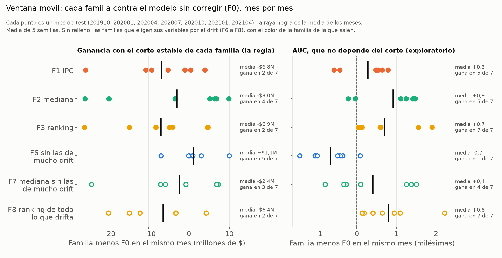
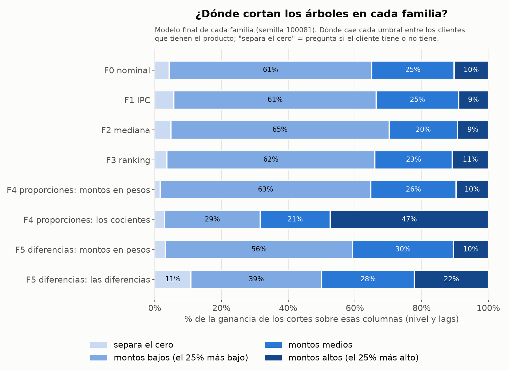
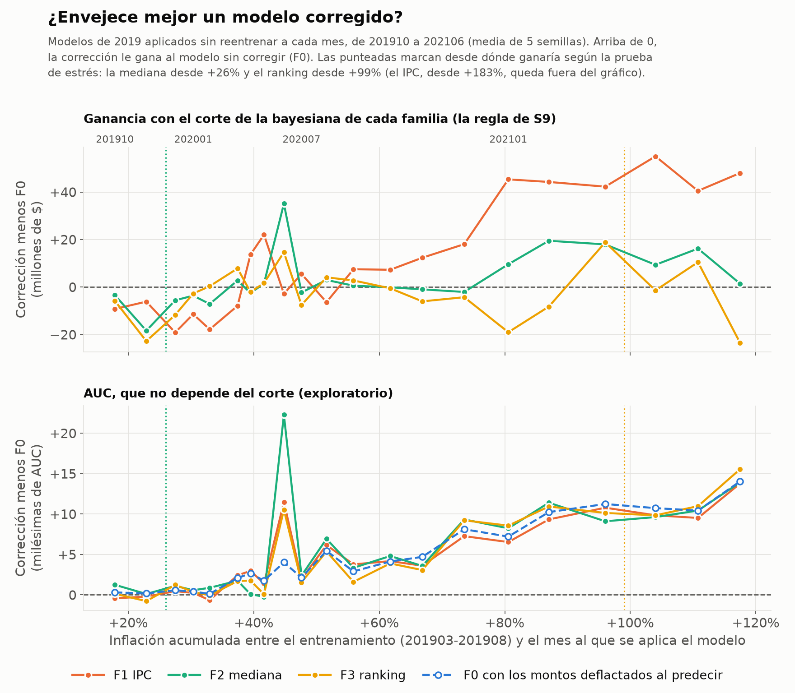
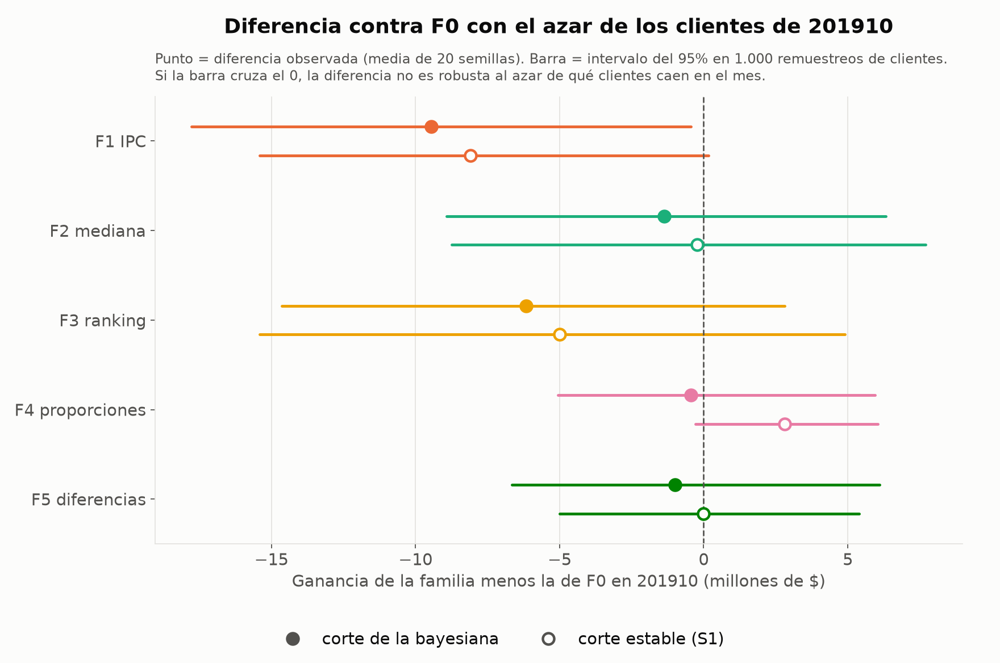

# ¿Conviene corregir la inflación antes de entrenar un modelo de churn?

Ana Dominguez, Nicolás Zarewsky y Valentín Turri (grupo Inflacion_2). DMEyF 2026, experimento colaborativo sobre inflación. Tutor: Joaquín I. Aramendía.

## Resumen

Un modelo de churn aprende umbrales en pesos, como "saldo menor a $50.000", y los aplica meses después, cuando los precios ya subieron. Probamos si corregir la inflación de las variables en pesos antes de entrenar sube la ganancia de una campaña de retención. Con el baseline de la cátedra (LightGBM, una optimización bayesiana por familia, 20 semillas) y reglas de decisión escritas antes de mirar el test, comparamos el modelo sin corregir (F0) con tres correcciones: deflactar por IPC (F1), dividir por la mediana del mes (F2) y pasar a ranking del mes (F3). En el mes de test del baseline (201910) ninguna corrección le gana al modelo sin corregir: la mediana casi empata (-$1,4M sobre $289M), el ranking pierde $6,2M y el IPC, $9,5M. En siete meses de test entre 2019 y 2021, con la misma ventana corrida en el tiempo, las tres correcciones empatan con el modelo sin corregir, y lo que pierden viene sobre todo de dónde cortan. Corregir baja el drift de la variable típica, pero los árboles cortan los montos sobre todo en "no tiene" o en montos bajos, que la inflación casi no mueve, y entre el entrenamiento y el test los precios suben menos de 20%. Si el modelo no se reentrena, la respuesta cambia: aplicados sin reentrenar hasta 2021, los modelos corregidos ordenan mejor a los clientes desde unos +35% de inflación acumulada, y en 2021 ganan entre $12M y $19M más por mes (exploratorio). La misma ventaja se obtiene dividiendo los montos por la inflación acumulada al predecir, sin entrenar otro modelo. Agregar proporciones del propio cliente, que no tienen inflación, mejoró en un mes pero no se confirmó en otro. Sacar las variables con mucho drift, o pasar a ranking también las no monetarias que cambian, tampoco sube la ganancia en los siete meses de test. Con reentreno frecuente, corregir la inflación no hace falta; si el modelo se usa muchos meses sin reentrenar, conviene deflactar los montos al predecir.

## 1. Introducción

Entre marzo y octubre de 2019 el IPC subió 27%. Un árbol que aprendió "saldo menor a $50.000" en marzo aplica el mismo umbral en octubre, cuando $50.000 ya valen otra cosa. Además, cada variable tiene su propia inflación (`scripts/00_diagnostico_inflacion.py`):

- el sueldo acreditado sigue al IPC (+26%), con un salto de +52% en junio por el aguinaldo;
- el saldo en cuentas sube apenas 8%, y el consumo con Visa, 42%;
- los límites de las tarjetas no se mueven mes a mes: el banco los sube por escalones (+40% de golpe en mayo);
- las variables en dólares expresadas en pesos saltan con la devaluación de agosto.


Un único índice externo no puede corregirlas a todas. La mediana del mes corrige cada variable con su propio movimiento, y además absorbe el aguinaldo. El otro grupo del tema (Inflacion_1) estudia deflactores externos por tipo de variable; este trabajo va por el lado opuesto: corregir con los datos del propio mes.

**Hipótesis principal.** Corregir la inflación con datos del propio mes (dividir por la mediana del mes o pasar a ranking) da más ganancia que no corregir, y al menos la misma que deflactar por IPC, sin depender del INDEC. El argumento tiene dos pasos, que se miden por separado: (a) la corrección baja el drift de las variables en pesos, y (b) eso sube la ganancia.

**Hipótesis secundarias**, planteadas después de ver el resultado principal, cada una con su regla escrita antes de correrla:

1. **Más meses.** El resultado principal se repite en otros meses de test.
2. **Más inflación.** Corregir conviene a partir de cierta inflación entre el entrenamiento y el test.
3. **Información sin inflación.** Agregar proporciones del propio cliente, en las que la inflación se cancela, sube la ganancia.
4. **Drift en general.** Sacar las variables con mucho drift, o pasar a ranking también las no monetarias que cambian, sube la ganancia.

## 2. Métodos

### 2.1 Datos y ventanas

- **Datos**: el dataset de la Segunda Competencia (201901 a 202108), con la clase ternaria calculada con todos los meses. El target junta BAJA+1 y BAJA+2. Las features son las 152 originales con lags y deltas de orden 1 y 2 (760 columnas).
- **Variables en pesos**: las 73 que el diccionario de datos marca en pesos (las que empiezan con `m`, `Visa_m` o `Master_m`, incluidas las de dólares expresadas en pesos). La corrección se aplica antes de calcular lags y deltas; cantidades, flags, edad y antigüedad quedan igual en todas las familias.
- **Ventana del baseline** (consigna de Alejandro Bolaños): entrena con 201903-201906, valida en 201908 (AUC y corte) y testea en 201910 (ganancia). El modelo final reentrena con 201903-201908.
- **Ventana móvil**: la misma ventana corrida en el tiempo, para 7 meses de test (201910, 202001, 202004, 202007, 202010, 202101 y 202104). Para el mes de test t, entrena de t-7 a t-4, valida en t-2 y reentrena de t-7 a t-2. Entre el reentreno y el test los precios suben de 9% a 19%.
- **Modelo que envejece**: los modelos finales de 2019 (entrenados con 201903-201908) aplicados sin reentrenar a cada mes de 201910 a 202106. La inflación acumulada contra el entrenamiento va de +18% a +117%.

### 2.2 Familias

Ejemplo con números redondos: en octubre, un cliente tiene $60.000 de saldo y cobra $80.000 de sueldo; entre los clientes que tienen saldo, la mediana es $40.000.

| Familia | Qué hace con las variables en pesos | El saldo del ejemplo queda | ¿Datos externos? |
|---|---|---|---|
| **Sin corregir (F0)** | nada: es el baseline | 60.000 | no |
| **IPC (F1)** | lleva todo a pesos de octubre con el IPC del INDEC | 60.000 (un saldo de $50.000 en marzo pasa a 63.500) | sí |
| **Mediana del mes (F2)** | divide por la mediana del mes entre los clientes que tienen el producto | 1,5 (una vez y media el saldo típico) | no |
| **Ranking del mes (F3)** | la posición del cliente en el mes, con el cero fijo (positivos entre 0 y 1, negativos entre -1 y 0) | 0,80 (más saldo que el 80% de los que tienen) | no |
| **Proporciones (F4)** | deja los montos como F0 y **agrega** 11 cocientes del propio cliente | 60.000, y además saldo / sueldo = 0,75 | no |
| **Diferencias (F5)** | control de F4: los mismos 11 pares, restados en vez de divididos | 60.000, y además saldo - sueldo = -20.000 | no |
| **Sin las de mucho drift (F6)** | F0 sin las variables con PSI > 0,25 (ni sus lags y deltas) | 60.000, o se saca | no |
| **Mediana sin las de mucho drift (F7)** | F2 sin las variables con PSI > 0,25, medido después de dividir por la mediana | 1,5, o se saca | no |
| **Ranking de todo lo que drifta (F8)** | F3, más el ranking de las variables no monetarias con PSI > 0,1 | 0,80 | no |

- **F0 a F3 tienen las mismas 760 columnas**: si una corrección gana, es por la corrección y no por tener más variables.
- **F5 es el control de F4.** En un cociente la inflación se cancela, porque mueve igual al numerador y al denominador; en una resta, no. Si las proporciones le ganan a las diferencias, lo que ayuda es sacar la escala (la inflación o el tamaño del cliente); si empatan, es la información nueva.
- **F6 a F8 eligen sus variables en cada ventana**, con el PSI entre los meses del reentreno y el de test. El PSI no usa la clase, así que se puede calcular en producción. Los umbrales son los de la convención usual: 0,1 es un cambio moderado y 0,25, uno fuerte.

<details>
<summary>Las 11 proporciones y otras decisiones de diseño</summary>

- **Las 11 proporciones** (`config.PROPORCIONES`): saldo, consumo con tarjetas, préstamos, débitos y extracciones, cada uno dividido por el sueldo; uso del límite y pago del saldo, de Visa y de Master; consumo en dólares sobre consumo total (Visa); y dolarización (ahorros en dólares sobre el total). Quedaron afuera las transferencias (rotas de 201901 a 201905) y los débitos de Visa (rotos en 201904).
- **Mediana sin ceros**: muchas variables tienen mediana 0 (la mayoría no tiene plazo fijo ni préstamos). Todas se dividen por la mediana de los clientes que tienen el producto, en valor absoluto: es una sola regla, respeta el signo de los saldos negativos y no se mueve si cambia cuántos clientes no tienen el producto. El modelo nunca ve la mediana.
- **Empates en el ranking**: los clientes con el mismo monto comparten el valor (la fracción de clientes con un monto menor o igual).
- **Mes de referencia del IPC**: multiplicar todo por una constante no cambia los árboles, así que pesos de octubre o de marzo dan el mismo modelo. Serie del INDEC: IPC nacional, nivel general (`148.3_INIVELNAL_DICI_M_26` de datos.gob.ar).
- **Variables en dólares expresadas en pesos**: la mediana y el ranking las corrigen con su propio movimiento; el IPC se les aplica igual.
- **Celdas rotas**: no se corrigen, igual que en el baseline. 201910 tiene 14 variables en 0 para todos los clientes, y 201905 tiene 9 (`output/celdas_rotas.csv`).

</details>

### 2.3 Entrenamiento, ganancia y corte

- **Modelo**: LightGBM, con una optimización bayesiana por familia (`scripts/03_optimizar.py`): 50 intentos sobre 5 hiperparámetros (`num_leaves`, `learning_rate`, `min_data_in_leaf`, `feature_fraction` y `bagging_fraction`), el resto en el default, y la cantidad de árboles del early stopping en validación. Misma semilla y mismos rangos en todas las familias. F6 a F8 usan los hiperparámetros de la familia de la que salen, y la ventana móvil, los de la bayesiana de 2019.
- **Ganancia**: +$1.072.500 por cada BAJA+2 estimulado y -$27.500 por cada estímulo a otro cliente. Se estimula a los N clientes con más probabilidad: N es el corte.
- **El corte se elige en validación, nunca en el test.** Hay dos reglas: el de la bayesiana (el N que maximiza la ganancia del mejor intento en validación) y el corte estable (el máximo de la curva de ganancia promedio de todas las semillas en validación).
- **Semillas**: 20 en el experimento principal y 5 en la ventana móvil y en el modelo que envejece. Son las mismas en todas las familias, para comparar de a pares.

### 2.4 Reglas de decisión

Cada regla quedó escrita en el repositorio antes de correr su prueba; la última columna es el commit.

| Pregunta | Prueba | Regla | Escrita en |
|---|---|---|---|
| ¿Corregir sube la ganancia? | 201910, 20 semillas, corte de la bayesiana | una familia supera a F0 si gana en promedio por más que el desvío entre semillas de F0 y el Wilcoxon pareado por semilla da p < 0,05 | [6ae70a0](https://github.com/nicozare/experimento-inflacion-dmeyf/commit/6ae70a0) |
| ¿Se repite en otros meses? | ventana móvil: 7 meses, 5 semillas, corte estable | supera a F0 si la diferencia media por mes es positiva y el Wilcoxon pareado por mes da p < 0,05; pierde si es negativa con p < 0,05; si no, empata | [055da5d](https://github.com/nicozare/experimento-inflacion-dmeyf/commit/055da5d) |
| ¿Desde cuánta inflación conviene corregir? | modelo que envejece, con el corte de la bayesiana de cada familia | la predicción de la prueba de estrés (la mediana desde +26%, el ranking desde +99%) se cumple si la corrección le gana a F0 en al menos 2 de cada 3 meses por encima de su umbral | [055da5d](https://github.com/nicozare/experimento-inflacion-dmeyf/commit/055da5d) |
| ¿La ventaja viene de la corrección o de los hiperparámetros? | el IPC con los hiperparámetros de F0, y los modelos de F0 con los montos deflactados al predecir | viene de la corrección (o alcanza con deflactar al predecir) si la variante gana en 2021 al menos la mitad del AUC que gana el IPC | [1cee062](https://github.com/nicozare/experimento-inflacion-dmeyf/commit/1cee062) |
| ¿Ayuda agregar proporciones? | F4 en 201910, y otra vez con todo el protocolo un mes antes (test 201909) | la regla de la primera fila; se confirma si en 201909 supera a F0 con los dos cortes | [75c4c4a](https://github.com/nicozare/experimento-inflacion-dmeyf/commit/75c4c4a), [73adc13](https://github.com/nicozare/experimento-inflacion-dmeyf/commit/73adc13) |
| ¿Es por sacar la inflación? | F4 contra F5 en 201910 | la regla de la primera fila, con el desvío de F5, con los dos cortes | [73adc13](https://github.com/nicozare/experimento-inflacion-dmeyf/commit/73adc13) |
| ¿Ayuda sacar o rankear lo que drifta? | F6 a F8 en la ventana móvil | la regla de la ventana móvil, contra F0 y contra su familia de origen (F7 contra F2, F8 contra F3) | [055da5d](https://github.com/nicozare/experimento-inflacion-dmeyf/commit/055da5d) |

Lo que sale de aplicar estas reglas es confirmatorio. Lo demás es exploratorio y se marca así: mirar la curva del test a igual cantidad de clientes, el AUC del modelo que envejece o los tramos de inflación. Las hipótesis secundarias se plantearon después de mirar octubre, así que aun con la regla escrita antes, sus ideas salieron del test.

Además, cinco análisis explican los resultados sin decidir nada:

- **Drift** (`scripts/05_drift.py`): el PSI de cada variable y el AUC adversarial, que mide qué tan bien un modelo distingue filas del test de filas del entrenamiento (0,5 es que no las distingue).
- **Dónde cortan los árboles** (`scripts/09_donde_corta.py` y `13_donde_cortan_las_familias.py`): para cada corte sobre un monto, en qué parte de la distribución del mes cae el umbral, pesado por la ganancia del corte.
- **Prueba de estrés** (`scripts/11_estres_inflacion.py`): los montos de 201910 multiplicados por un factor, como si el test estuviera más lejos del entrenamiento.
- **Azar de los clientes** (`scripts/10_bootstrap_clientes.py`): 1.000 remuestreos de los clientes del mes de test, los mismos para todas las familias.
- **Corte estable y ensambles** (`scripts/07_validacion_semillas.py` y `08_corte_estable_y_ensamble.py`): cada familia con el corte estable, y F0 promediado con otra familia contra F0 promediado con otra semilla de sí mismo.

## 3. Resultados

### 3.1 Corregir no sube la ganancia

| Familia | Ganancia en 201910 (20 semillas) | Contra F0 | Semillas en que gana | Wilcoxon p | ¿Supera a F0? |
|---|---|---|---|---|---|
| Sin corregir (F0) | $289,0M ± $2,2M | | | | |
| IPC (F1) | $279,6M ± $3,4M | -$9,5M | 0 de 20 | < 0,001 | no |
| Mediana del mes (F2) | $287,6M ± $2,1M | -$1,4M | 7 de 20 | 0,034 | no |
| Ranking del mes (F3) | $282,9M ± $3,0M | -$6,2M | 2 de 20 | < 0,001 | no |

El ± es el desvío entre semillas. Cada familia usa el corte que eligió en 201908.


- **Ninguna corrección supera al modelo sin corregir.** La mediana casi empata (pierde por menos que el desvío entre semillas), y el IPC pierde en las 20 semillas.
- **La mediana y el ranking le ganan al IPC** (+$8,1M en las 20 semillas y +$3,3M en 15 de 20): la segunda parte de la hipótesis se cumple, pero no resiste el azar de los clientes (sección 3.6).
- **El ranking pierde por el corte más que por cómo ordena**: en 201908 eligió 3.500 clientes, y en octubre su curva es la más alta desde los ~4.100 (exploratorio, porque mira el test).

**En siete meses de test.** Con la ventana móvil, ninguna corrección supera al modelo sin corregir: las tres empatan por la regla. Es lo que predijimos antes de correrla ([6980a27](https://github.com/nicozare/experimento-inflacion-dmeyf/commit/6980a27)): entre el reentreno y el test hay de +9% a +19% de inflación, el rango en que, en el modelo que envejece, ninguna corrección ganaba.

| Corrección | Diferencia media por mes contra F0 | Meses en que gana | Wilcoxon p (por mes) | Resultado |
|---|---|---|---|---|
| IPC (F1) | -$6,8M | 2 de 7 | 0,109 | empata |
| Mediana del mes (F2) | -$3,0M | 4 de 7 | 1,000 | empata |
| Ranking del mes (F3) | -$6,9M | 2 de 7 | 0,156 | empata |



- **Lo que pierden es sobre todo por el corte** (exploratorio). Si estimulan la misma cantidad de clientes que el modelo sin corregir, la mediana empata (-$0,3M por mes) y el IPC y el ranking pierden menos (-$3,5M y -$2,4M). Con el mejor corte de cada una, las tres quedan a menos de $1M por mes.
- **El peor mes es 202004, y es por el corte.** Su corte se elige en 202002, que tuvo 213 BAJA+2 contra 524 del test, así que todas cortan corto: el modelo sin corregir estimula 2.000 clientes y las correcciones, entre 1.200 y 1.300, cuando el mejor corte rondaba los 6.300. Ahí las tres pierden unos $26M.
- **Ordenan apenas mejor.** El AUC de las correcciones supera al del modelo sin corregir por +0,3 a +0,9 milésimas en promedio: más de diez veces menos que en el modelo que envejece en 2021 (sección 3.3).

### 3.2 Por qué: el drift baja, pero el modelo casi no mira el nivel de precios

| Familia | PSI mediano: saldos, consumos y pagos | PSI mediano: límites y comisión | AUC adversarial |
|---|---|---|---|
| Sin corregir (F0) | 0,006 | 0,031 | 0,810 |
| IPC (F1) | 0,003 | 1,014 | 0,874 |
| Mediana del mes (F2) | 0,002 | 0,039 | 0,854 |
| Ranking del mes (F3) | 0,001 | 0,330 | 0,867 |

- **El primer paso de la hipótesis se cumple a medias.** Las tres correcciones bajan el drift de saldos, consumos y pagos. Pero los límites de tarjeta y la comisión de mantenimiento el banco los ajusta por escalones: el IPC les inventa una caída real todos los meses hasta el próximo escalón, y el ranking también los empeora. Solo la mediana los deja como estaban.
- **Octubre sigue siendo distinguible.** El AUC adversarial no baja con ninguna corrección, porque el cambio que pesa en octubre es el comportamiento en dólares después de las PASO (devaluación de agosto, cepo de septiembre), que no es inflación. El AUC de la tabla usa solo variables continuas: con todas, el IPC y el ranking llegan a 1,000 por un artefacto de los límites.
- **Los árboles cortan los montos donde la inflación casi no llega.** En el modelo sin corregir, el 65% de la ganancia de los cortes sobre montos pregunta si el cliente tiene o no el producto, o si está entre el 25% que tiene menos. Con la inflación de 2019, cada uno de esos cortes cambiaría de rama, en promedio, al 1,4% de los clientes. Corregir cambia la escala, pero no la pregunta: con el IPC, la mediana o el ranking, entre el 65% y el 70% de esa ganancia sigue en "no tiene" o en montos bajos.
- **El modelo aprendió con la inflación adentro.** Si al modelo sin corregir se le da octubre llevado a pesos del entrenamiento, elige el 96% de los mismos clientes y gana menos ($287,1M contra $293,7M, en una semilla). En el entrenamiento, un saldo nominal quieto ya era una caída real.



### 3.3 Sin reentrenar, corregir ayuda desde unos +35% de inflación acumulada

**Prueba de estrés.** Con los montos de octubre multiplicados por un factor, el modelo sin corregir pierde de a poco: con los montos multiplicados por 3, $12,7M (4%). Según el punto en que queda debajo de cada corrección, la mediana convendría desde ~+26% de inflación entre el entrenamiento y el test, el ranking desde ~+99% y el IPC desde ~+183%.

**Modelo que envejece.** Con la regla, esa predicción no se cumple: la mediana le gana al modelo sin corregir en 11 de los 19 meses por encima de +26% (hacían falta 13), y el ranking en 1 de los 3 por encima de +99%. Pero la regla quedó confundida por el corte fijo. Cada familia estimula siempre la cantidad de clientes que eligió en 2019 (de 3.500 a 5.000), y en 2021 hay casi el doble de BAJA+2: el mejor corte del modelo sin corregir pasa de 4.000 a unos 9.800 clientes. Con un corte fijo gana sola la familia que más estimula (el IPC, +$46M por mes en 2021) y pierde sola la que menos (el ranking), corrijan o no.

Sin depender del corte (exploratorio), las tres correcciones envejecen mejor que el modelo sin corregir. Diferencia contra F0:

| Inflación acumulada | hasta +30% (201910 a 202001) | +33% a +74% (resto de 2020) | +81% a +117% (2021) |
|---|---|---|---|
| AUC (no depende del corte) | 0,0 a +0,8 milésimas | +3,5 a +5,0 milésimas; las tres ganan en 10 de 11 meses | +10,0 a +11,0 milésimas; las tres ganan los 6 meses |
| Ganancia con el mejor corte de cada una (mira el test) | -$5,5M a -$3,2M; pierden en 11 de 12 casos | +$3,8M a +$5,8M; ganan en 7 a 10 de 11 meses | +$12,2M a +$19,0M; las tres ganan los 6 meses |



- **La ventaja crece con la inflación acumulada** (correlación de Spearman del AUC entre 0,80 y 0,87) y es casi igual en las tres correcciones, aunque tienen hiperparámetros distintos (en 202104: +9,8, +9,6 y +9,8 milésimas). Lo común a las tres es sacar el nivel de precios.
- **La ventaja es de la corrección, no de los hiperparámetros** (control con regla). El IPC entrenado con los hiperparámetros del modelo sin corregir gana +10,1 milésimas de AUC en 2021, lo mismo que con los suyos (+10,0).
- **Alcanza con deflactar al predecir.** Los mismos modelos sin corregir, con cada mes llevado a precios del entrenamiento con un solo factor, ganan +10,6 milésimas de AUC en 2021 sin entrenar nada: +$18,9M por mes con el mejor corte y +$13,6M con el mismo corte de 4.000 clientes. Con la inflación de 2019 (hasta +30%), en cambio, deflactar al predecir no ayuda (-$4,3M con el mejor corte), como en la sección 3.2.
- **La prueba de estrés anticipó la idea, pero no los umbrales**: multiplicar los montos de un mes por un factor parejo no reproduce 18 meses reales. Y la inflación acumulada avanza junto con el tiempo y la pandemia, así que esto no separa "más inflación" de "más meses sin reentrenar"; lo que el control sí muestra es que sacar el nivel de precios alcanza para recuperar la ventaja.

### 3.4 Agregar proporciones del cliente: mejora en un mes, no se confirma

| Comparación | Mes de test | Corte | Diferencia media | Gana en | Wilcoxon p | ¿Supera? |
|---|---|---|---|---|---|---|
| Proporciones (F4) contra F0 | 201910 | de la bayesiana | -$0,4M | 11 de 20 | 0,626 | no |
| Proporciones (F4) contra F0 | 201910 | estable | +$2,8M | 17 de 20 | 0,002 | **sí** |
| Proporciones (F4) contra F0 | 201909 | de la bayesiana | -$0,8M | 8 de 20 | 0,268 | no |
| Proporciones (F4) contra F0 | 201909 | estable | +$2,7M | 14 de 20 | 0,027 | no, por poco: el desvío de F0 es $2,8M |
| Proporciones (F4) contra diferencias (F5) | 201910 | de la bayesiana | +$0,6M | 13 de 20 | 0,561 | no |
| Proporciones (F4) contra diferencias (F5) | 201910 | estable | +$2,8M | 16 de 20 | 0,005 | no, por poco: el desvío de F5 es $2,8M |

- **La mejora no se confirma**: en 201909 las proporciones no superan al modelo sin corregir con ninguna de las dos reglas de corte. Lo que sí se repite en los dos meses es exploratorio: a igual cantidad de clientes, entre 3.800 y 5.000, su curva queda arriba ($1,6M a $4,0M).
- **El control no separa las explicaciones.** Las diferencias (F5) empatan con el modelo sin corregir (-$1,0M y $0,0M), así que las proporciones no ganan por la información nueva sola; y tampoco superan a las diferencias con la regla. Cerca del mejor corte, dividir parece mejor que restar, sin llegar a probarlo.
- **Qué aportan**: las 11 proporciones son el 8,9% de la ganancia de los cortes, y la ventaja viene de los clientes que no cobran el sueldo en el banco (+$1,7M de +$2,2M con 4.000 clientes). A diferencia de los montos, sus cortes caen en valores altos: casi la mitad de su ganancia está en el 25% más alto (mucha dolarización, mucho uso del límite).

### 3.5 Sacar o rankear lo que drifta tampoco ayuda

Con la ventana móvil y su regla (siete meses de test, 5 semillas, corte estable). Son los puntos sin relleno del gráfico de la sección 3.1.

| Familia | Contra | Diferencia media por mes | Meses en que gana | Wilcoxon p (por mes) | Resultado |
|---|---|---|---|---|---|
| Sin las de mucho drift (F6) | sin corregir (F0) | +$1,1M | 5 de 7 | 0,312 | empata |
| Mediana sin las de mucho drift (F7) | sin corregir (F0) | -$2,4M | 3 de 7 | 0,938 | empata |
| Mediana sin las de mucho drift (F7) | mediana del mes (F2) | +$0,6M | 5 de 7 | 0,438 | empata |
| Ranking de todo lo que drifta (F8) | sin corregir (F0) | -$6,4M | 2 de 7 | 0,297 | empata |
| Ranking de todo lo que drifta (F8) | ranking del mes (F3) | +$0,5M | 3 de 7 | 1,000 | empata |

- **Ninguna supera a su referencia.** Sacar las variables de mucho drift (F6) es la única con el promedio a favor del modelo sin corregir, pero gana en 5 de los 7 meses y la regla pide 6. Rankear todo lo que drifta (F8) pierde en 5 de los 7, igual que el ranking del mes (F3) del que sale.
- **Lo que se saca casi no es inflación.** Cada ventana saca entre 3 y 20 variables (con sus lags y deltas) y rankea entre 7 y 14 no monetarias más. En 6 de las 7 ventanas, las dos de más drift son los días desde el último cierre de Visa y de Master, que dependen del calendario de cierres; después suelen venir el uso de la app y de internet, que crece con los meses.
- **Sin depender del corte (exploratorio).** Sacar las de mucho drift ordena apenas peor que el modelo sin corregir (AUC -0,7 milésimas, gana en 1 de 7 meses), y estimulando la misma cantidad de clientes gana $0,4M por mes. Rankear todo lo que drifta ordena mejor en los 7 meses, pero por 0,8 milésimas, y con el mismo corte que el modelo sin corregir pierde $2,7M por mes: la mejora del orden queda fuera de la punta de la lista, que es la que se estimula. Al ranking del mes (F3) le pasa lo mismo.

La hipótesis del drift en general no se sostiene: con el modelo reentrenado cerca del mes de test, el drift de estas variables no es lo que lo limita.

### 3.6 El azar del mes y el corte pesan tanto como la familia

- **El azar de los clientes pesa de 2 a 7 veces más que el de las semillas.** Con 1.000 remuestreos de los clientes de octubre, lo único que resiste es que el IPC pierde contra el modelo sin corregir (intervalo del 95%: -$17,8M a -$0,4M). Que la mediana le gane al IPC no resiste por poco (96% de los remuestreos a favor), y el "sí" de las proporciones con el corte estable, tampoco.
- **El mejor corte cambia de un mes a otro.** Con el corte estable de 20 semillas, ninguna corrección supera al modelo sin corregir, y el ranking vuelve a elegir 3.500 clientes: no es ruido de un modelo, sino que el mejor corte de agosto no es el de octubre. Y cuando cambia la cantidad de bajas, un corte fijo favorece a la familia que más estimula (sección 3.3).
- **Las correcciones tampoco sirven como complemento.** Promediar el modelo sin corregir con una corrección rinde menos que promediarlo con otra semilla de sí mismo (de -$5,2M a -$6,4M, en las 20 semillas), y con las proporciones o las diferencias tampoco lo supera (-$0,4M y -$1,3M).



## 4. Discusión: lo que el diseño nos cuidó de creer

- **Sesgo de confirmación**: esperábamos que corregir ayudara, y en la curva de octubre es fácil encontrar un corte en el que el ranking "gana". La regla y el corte fijados antes de mirar el test evitaron declararlo.
- **Quedarse con la regla que conviene**: con las proporciones, una regla de corte decía que sí y la otra que no. Reportamos las dos, y antes de festejar las probamos en otro mes y contra un control, que no lo confirmaron.
- **Confundir ruido de semilla con evidencia**: un Wilcoxon con p = 0,002 sobre 20 semillas parecía contundente; el azar de los clientes del mes es mucho más grande.
- **Creer que menos drift es mejor modelo**: medir el drift aparte de la ganancia mostró que pueden ir por caminos distintos.
- **Leer una regla confundida como evidencia**: en el modelo que envejece, la regla con el corte fijo daba ganadora a la familia que más estimula. La reportamos como no cumplida y separamos lo exploratorio.

## 5. Limitaciones

- **Un mes de test en el experimento principal y una bayesiana por familia.** El desvío entre semillas no incluye la variabilidad de la optimización ni la de los clientes del mes, que pesa más.
- **La ventana móvil y el modelo que envejece usan los hiperparámetros de 2019** y 5 semillas. Rehacer la bayesiana en cada ventana no entraba en el tiempo disponible.
- **Con 7 meses, la regla de la ventana móvil es exigente**: el Wilcoxon da p < 0,05 solo si una familia gana (o pierde) en al menos 6 de los 7 meses. Un empate ahí dice que no hay una diferencia consistente, no que las familias sean iguales.
- **2019 es un año particular**: devaluación después de las PASO, y en 2020-2021, la pandemia. Les pasa a todas las familias por igual, pero cambia qué distingue a un mes de otro.
- **El IPC del mes se usa como si estuviera disponible**: en producción se publica a mitad del mes siguiente. Vale para el IPC (F1) y para deflactar al predecir; es una ventaja a su favor.
- **La mediana y el ranking borran también los cambios reales**: si todo el banco se empobrece en un mes, no lo ven.
- **El reentreno usa la cantidad de árboles del early stopping con 4 meses**, aunque entrena con 6.
- **Los análisis de dónde cortan los árboles miran un modelo por familia** (una semilla), y la prueba de estrés, 5 semillas.

## 6. Conclusiones

1. **Con reentreno frecuente, corregir la inflación de las variables en pesos no sube la ganancia.** En 201910 ninguna corrección le gana al modelo sin corregir, y en siete meses de test entre 2019 y 2021 las tres empatan con él. La hipótesis principal no se sostiene.
2. **Bajar el drift no alcanza.** Las correcciones bajan el PSI de la variable típica, pero los árboles cortan los montos en "no tiene" o en montos bajos, que la inflación casi no mueve, y el cambio de octubre que pesa no es de precios.
3. **Sin reentrenar, la inflación sí pesa.** Desde unos +35% de inflación acumulada, las tres correcciones ordenan mejor que el modelo sin corregir, y en 2021 suman de $12M a $19M por mes con su mejor corte (exploratorio). Lo que ayuda es sacar el nivel de precios, y para eso alcanza con dividir los montos por la inflación acumulada al predecir.
4. **Si igual se quiere corregir antes de entrenar, conviene la mediana del mes y no el IPC.** La mediana es la corrección que menos pierde contra el modelo sin corregir: -$1,4M en 201910, contra -$9,5M del IPC, y -$3,0M por mes en la ventana móvil, contra -$6,8M. Además se calcula con los datos del propio banco, sin esperar al INDEC, y no les inventa caídas a los límites de tarjeta, que el banco sube de golpe cada tantos meses. Y que el IPC pierde es lo único que se sostiene al remuestrear los clientes del mes.
5. **Ni agregar información sin inflación ni sacar lo que drifta suben la ganancia.** Las proporciones no superaron al modelo sin corregir en otro mes, ni a su control con diferencias. Sacar las variables con mucho drift, o pasar a ranking también las no monetarias que cambian, empata con el modelo sin corregir en los siete meses de test.
6. **Con un mes de test, el azar del mes y el corte pesan tanto como la familia.** Fijar la regla y el corte antes de mirar el test nos evitó declarar ganadores que no lo eran.

## 7. Qué seguiríamos probando

1. **Deflactar al predecir con un factor de los propios datos** (por ejemplo, la mediana de los montos del mes), sin esperar al IPC, que se publica con un mes de rezago.
2. **Corregir solo las variables de mercado** y dejar en nominal las que el banco ajusta por escalones (límites y comisión de mantenimiento).
3. **Elegir el corte como proporción de clientes, o con varios meses de validación**, porque el mejor corte cambia con la cantidad de bajas.
4. **Rehacer la bayesiana en cada ventana** y usar más semillas en el modelo que envejece.

## Anexo A. Cómo reproducirlo

Requiere [uv](https://docs.astral.sh/uv/) y el dataset `competencia_02_crudo.csv.gz` en `data/` (o la variable de entorno `CRUDO` apuntando a él).

```bash
uv sync
# experimento principal (2019)
uv run python scripts/01_preparar_base.py              # 2019 + clase_ternaria                   (~1 min)
uv run python scripts/02_corregir_y_fe.py              # F0 a F3: corrección, lags y deltas      (~1,5 min)
uv run python scripts/02b_proporciones.py              # F4: proporciones                        (~20 s)
uv run python scripts/02b_proporciones.py --operacion diferencia   # F5: diferencias             (~20 s)
uv run python scripts/00_diagnostico_inflacion.py      # gráficos de diagnóstico                 (segundos)
uv run python scripts/05_drift.py                      # PSI y AUC adversarial de F0 a F3        (~30 s)
uv run python scripts/03_optimizar.py                  # bayesiana, 50 intentos por familia      (1,5 a 2 h por familia)
uv run python scripts/04_entrenar_final.py             # 20 semillas por familia, test 201910    (40 min a 1,5 h por familia)
uv run python scripts/07_validacion_semillas.py        # 20 semillas por familia en 201908       (30 min a 1 h por familia)
uv run python scripts/06_resumen.py                    # tablas, tests y gráficos principales    (segundos)
uv run python scripts/08_corte_estable_y_ensamble.py   # corte estable y ensambles               (segundos)
uv run python scripts/09_donde_corta.py                # dónde corta el modelo sin corregir      (~4 min)
uv run python scripts/10_bootstrap_clientes.py         # azar de los clientes                    (~15 s)
uv run python scripts/11_estres_inflacion.py           # prueba de estrés                        (~40 min)
uv run python scripts/12_por_que_f4.py                 # qué aportan las proporciones            (segundos, usa los modelos de 11)
uv run python scripts/13_donde_cortan_las_familias.py  # dónde cortan todas las familias         (~15 min)

# las proporciones con otro mes de test (201909): el mismo protocolo un mes antes, solo F0 y F4
VENTANA=201909 uv run python scripts/03_optimizar.py --metodos ninguna proporciones
VENTANA=201909 uv run python scripts/04_entrenar_final.py --metodos ninguna proporciones
VENTANA=201909 uv run python scripts/07_validacion_semillas.py --metodos ninguna proporciones
VENTANA=201909 uv run python scripts/08_corte_estable_y_ensamble.py
VENTANA=201909 uv run python scripts/06_resumen.py
VENTANA=201909 uv run python scripts/10_bootstrap_clientes.py

# más meses (201901 a 202106, en data/extendido/; necesita los modelos y las bayesianas de arriba)
DATOS=extendido uv run python scripts/01_preparar_base.py                                    # (~1,5 min)
DATOS=extendido uv run python scripts/02_corregir_y_fe.py --metodos ninguna ipc mediana ranking ranking_todo   # (~6 min, 20 GB)
DATOS=extendido uv run python scripts/14_modelo_que_envejece.py                              # modelo que envejece (~1 h 15 min)
DATOS=extendido uv run python scripts/14_modelo_que_envejece.py --control-hiperparametros    # control de hiperparámetros (~50 min)
DATOS=extendido uv run python scripts/15_barrida_movil.py                                    # ventana móvil, F0 a F3 y F6 a F8 (~27 h)
```

Tiempos medidos en una MacBook Pro M3 Pro (12 núcleos, 36 GB). La bayesiana ocupa ~7 GB de memoria: entra en una máquina de 16 GB cerrando lo demás. Opciones útiles:

- `--metodos mediana ranking` (o `--familias` en 15) para correr solo algunas familias.
- `--semillas 100081 100103` en 04 y 07 para correr solo algunas semillas; las que ya tienen resultado se saltean (`--forzar` para rehacerlas). 14 y 15 también retoman solos.
- 03 retoma solo si se corta (el estudio de Optuna queda en `data/optuna.db`) y saltea las familias que ya tienen su bayesiana completa.
- `HILOS=6` limita los núcleos que usa LightGBM.

Para comparar familias, el reentreno conviene correrlo en una sola máquina: así las diferencias no vienen de diferencias numéricas entre computadoras.

## Anexo B. Qué hay en cada carpeta

| Análisis | Código interno | Scripts | Salida |
|---|---|---|---|
| Experimento principal | | 03, 04, 06 | `output/resumen.md`, `output/resultados_por_semilla.csv` |
| Drift | | 05 | `output/drift_resumen.csv`, `output/drift_psi.png` |
| Corte estable y ensambles | S1, S2 | 07, 08 | `output/corte_estable_y_ensamble.md` |
| Proporciones (F4) | S3 | 02b, 03, 04, 07 | `output/resumen.md`, `output/curvas_f4_201910.png` |
| Dónde cortan los árboles | S4 | 09, 13 | `output/donde_corta.md`, `output/donde_cortan_las_familias.md` |
| Otro mes de test (201909) | S5 | 03 a 10 con `VENTANA=201909` | `output/test_201909/` |
| Azar de los clientes | S6 | 10 | `output/bootstrap_clientes.md` |
| Prueba de estrés | S7 | 11 | `output/estres_inflacion.md` |
| Qué aportan las proporciones y control con diferencias (F5) | S8 | 12, 02b | `output/por_que_f4.md`, `output/curvas_f5_201910.png` |
| Modelo que envejece y control de hiperparámetros | S9 | 14 | `output/barrida/envejece.md` |
| Ventana móvil y familias por drift (F6 a F8) | S10 | 15 | `output/barrida/movil.md` |

```
scripts/      00 a 15, config.py (todas las constantes) y comun.py
data/         crudo, base por mes, features por familia, estudio de Optuna y modelos guardados (no se versiona)
resultados/   bayesiana por familia, curvas y ganancias por semilla, y barrida/ (más meses)
output/       tablas, gráficos, test_201909/, barrida/ y logs/ de cada corrida
```

El detalle de cada análisis, con todas sus tablas, está en su salida y en la [versión anterior de este README](https://github.com/nicozare/experimento-inflacion-dmeyf/blob/1dcd479/README.md), organizada por análisis.

### Qué se reutilizó

- La consulta de `clase_ternaria` y la lógica de lags y deltas vienen del pipeline de la Primera Competencia (porteo de `dmeyf2026/monday/z101_target_sql.ipynb` y `z402_Feature_Engineering_en_SQL.ipynb`). Sin corrección, las features de 202106 coinciden celda por celda con las de ese pipeline.
- Antecedente: en la Primera Competencia, el ranking con cero fijo en todas las columnas subió la ganancia del holdout local (~$370M contra ~$360M) pero bajó la pública (75,9 contra 80,0).
